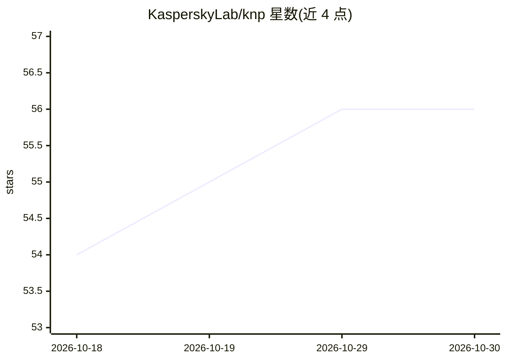

# KasperskyLab/knp

⭐ 56 · C++ · Apache-2.0 · 推送 2026-10-29 · [GitHub](https://github.com/KasperskyLab/knp) · 组织维护

**卡巴斯基脉冲神经网络平台：开发、训练与执行 SNN**

用于开发、训练和执行脉冲神经网络（SNN）的软件平台，面向从事神经网络研究的开发者与科研人员。支持在遥测、事件、图像、3D、音频、触觉等数据上创建与训练 SNN，可将人工神经网络（ANN）转换为脉冲网络，并支持开发新拓扑、突触可塑性模型与神经元模型。提供 C++ 与 Python 两种语言接口，后端覆盖 CPU、GPU 及 Motiv-NT 神经形态后端，可用于机器人、物联网、低功耗设备等场景。安装方式包括 deb 包、Python 开发包或源码构建；仅带 release 标签的版本具备发布质量。

## 筛选速览

| 维度 | 判定 | 备注 |
|---|---|---|
| AI 角色 | `ai-ecosystem` | LLM/agent 周边工具 |
| 许可风险 | `permissive` | Apache-2.0 |
| 部署形态 | `None` |  |
| 模型依赖 | — | README 未给出锁定关系 |
| 硬件要求 | — | 无带数字的原话,不猜 |
| 安装摩擦 | `medium` | 含编译或系统依赖之一 |
| 成熟度 | — | 结构信号不足 |

## 能力要点

- 创建并训练 SNN，支持 ANN 到脉冲网络的转换
- C++ 与 Python 双语言接口
- CPU、GPU 与神经形态（Motiv-NT）多后端
- 面向低功耗设备与神经形态处理器的应用开发

## 适用场景

- 在遥测、图像、音频等数据上做分类研究
- 把已有 ANN 模型转换为脉冲神经网络
- 为机器人、物联网、可穿戴设备开发神经形态应用方案

## 场景标签

`模型训练` `科研工具` · 领域:学习与行业

## 证据(README 行号)

> L7: The Kaspersky Neuromorphic Platform ("KNP" or "platform") is a software platform for developing, training and execut
> L20: You can use the C++ and Python languages to accomplish these tasks. Along with CPU and GPU backends, the platform s

## 星数曲线

2026-10-18 54 → 2026-10-30 56（+2）

---
*卡片 v1 · prompt 1.4 · 生成 2026-10-24 · 置信度 high · 依据 README sha `4a967492d48f` · [字段定义](../../DATASET.md)*
