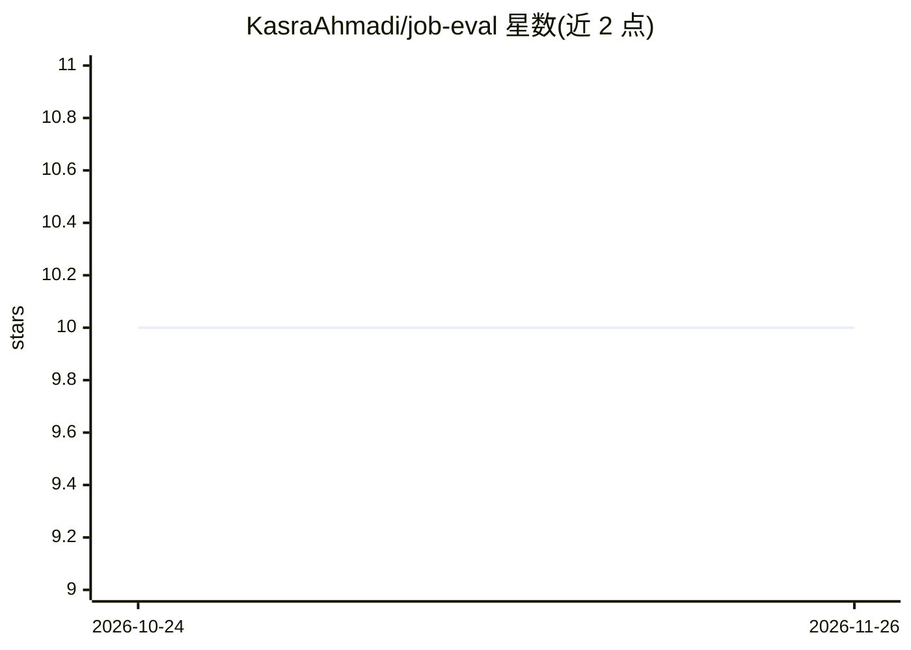

# KasraAhmadi/job-eval

⭐ 10 · Python · MIT · 推送 2026-08-11 · [GitHub](https://github.com/KasraAhmadi/job-eval) · 个人维护

**本地用 156M 模型给简历对多个职位打分并给出解释段落**

读取简历与职位描述列表，输出 1-5 分的四项评分（要求覆盖、资历匹配、领域对齐、ATS 关键词重叠）及每项驱动评分的具体段落。核心是专用训练的 156M 参数 ModernBERT 交叉编码器，经稀疏注意力（α-entmax）池化产生可追溯的证据引用。数据不出本机，无 API key，CPU 数秒或 GPU 即时运行；结果输出为 evaluation.csv 与 explanation.txt。简历支持 PDF/md/txt，职位支持 CSV、文本文件、文件夹或 URL。适用于自托管批量评估场景。

## 筛选速览

| 维度 | 判定 | 备注 |
|---|---|---|
| AI 角色 | `ai-native` | 本体是模型或模型工具 |
| 许可风险 | `permissive` | MIT |
| 部署形态 | `library` | 以包/库形式分发 |
| 模型依赖 | — | README 未给出锁定关系 |
| 硬件要求 | — | 无带数字的原话,不猜 |
| 安装摩擦 | `medium` | 含编译或系统依赖之一 |
| 成熟度 | — | 结构信号不足 |

## 能力要点

- 四个维度打分并引用驱动评分的原文段落
- 156M ModernBERT 交叉编码器，本地 CPU/GPU 运行，无 API key
- 支持 PDF/md/txt 简历与 CSV/文件夹/URL 等多种职位输入
- device: auto 自动检测 GPU 并回退 CPU

## 适用场景

- 把整个职位板块的岗位批量与自己简历比对打分
- 求职前按职位描述定位简历缺口
- 在自己机器上评估简历匹配度而不上传数据

## 场景标签

 · 领域:求职/简历筛选工具

## 证据(README 行号)

> L11: It's powered by a purpose-trained **156M-parameter ModernBERT cross-encoder** —
> L119: The model is a partially-unfrozen ModernBERT
> L6: `job-eval` reads your resume and a list of job descriptions and gives each one

## 星数曲线

2026-10-24 10 → 2026-11-26 10（+0）

---
*卡片 v1 · prompt 1.4 · 生成 2026-11-20 · 置信度 high · 依据 README sha `8bac9729b269` · [字段定义](../../DATASET.md)*
