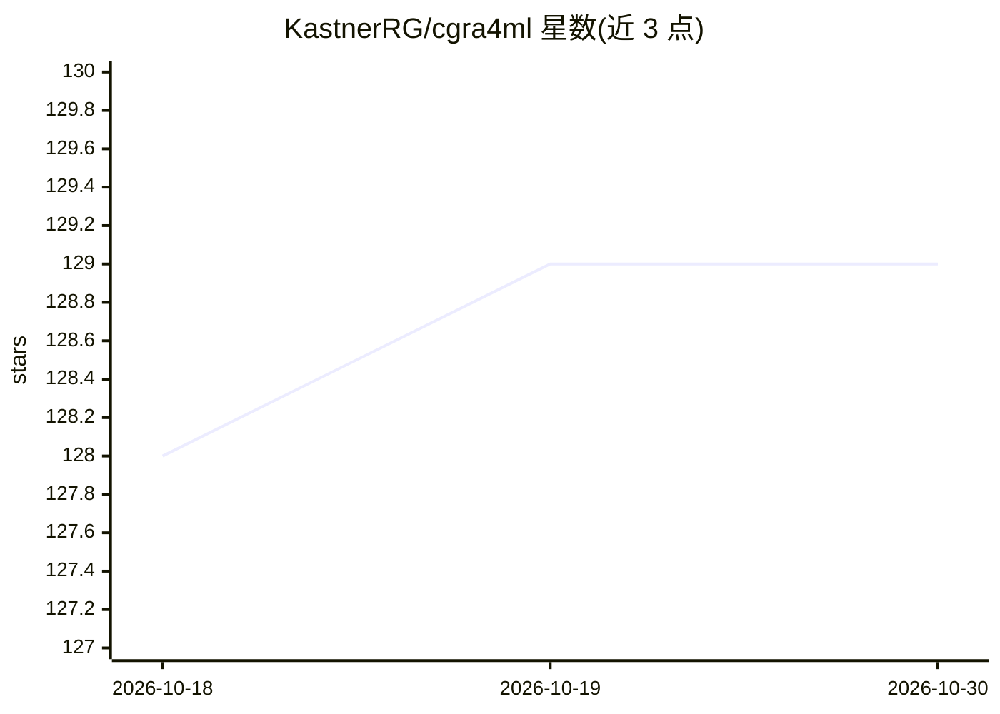

# KastnerRG/cgra4ml

⭐ 129 · SystemVerilog · Apache-2.0 · 推送 2026-09-06 · [GitHub](https://github.com/KastnerRG/cgra4ml) · 组织维护

**科研用框架：在 FPGA/ASIC 上实现深度模型的加速器与 SoC**

面向科研人员的 Python 库，用于构建、训练并把 ResNet CNN、自编码器、Transformer 等深度模型部署到 FPGA 与定制 ASIC。机制上基于 HLS4ML 的不足（每层一引擎），提供可静态/动态重配置的 AXI-Stream DNN 引擎，用户可通过 Python API 定制处理单元数据类型与架构。工作流覆盖仿真（Verilator/Vivado）、Vivado 生成比特流、ZYNQ 板卡运行、Ibex RISC-V SoC 集成（Docker 环境）以及 Cadence Genus/Innovus 的 ASIC 实现。限制：需自备仿真器/FPGA 工具链，ASIC 流程需添加自有 PDK。

## 筛选速览

| 维度 | 判定 | 备注 |
|---|---|---|
| AI 角色 | `ai-ecosystem` | LLM/agent 周边工具 |
| 许可风险 | `permissive` | Apache-2.0 |
| 部署形态 | `library` | 以包/库形式分发 |
| 模型依赖 | — | README 未给出锁定关系 |
| 硬件要求 | — | 无带数字的原话,不猜 |
| 安装摩擦 | `medium` | 含编译或系统依赖之一 |
| 成熟度 | — | 结构信号不足 |

## 能力要点

- 可重配置 AXI-Stream DNN 引擎，支持 ResNet/Autoencoder/Transformer 等模型
- 通过 Python API 定制处理单元数据类型与架构并扩展规模
- 覆盖 FPGA 比特流、ZYNQ 部署、Ibex SoC 仿真与 Cadence ASIC 实现流程
- 以 deepsocflow 包安装，示例含仿真与板级运行步骤

## 适用场景

- 科研团队把自训 DNN 模型部署到 FPGA/定制 ASIC 边缘平台
- 探索加速器数据流架构并按需定制处理单元
- 在 Ibex SoC 上仿真验证 DNN 加速器输出正确性

## 场景标签

`科研工具` · 领域:学习与行业

## 证据(README 行号)

> L3: cgra4ml is a Python library that helps researchers build, train, and implement their own deep ML models, such as Res
> L26: HLS4ML is an open source python framework that's being widely adopted by the scientific community, to generate FPGA

## 星数曲线

2026-10-18 128 → 2026-10-30 129（+1）

---
*卡片 v1 · prompt 1.4 · 生成 2026-10-22 · 置信度 mid · 依据 README sha `f52eed3c68a0` · [字段定义](../../DATASET.md)*
