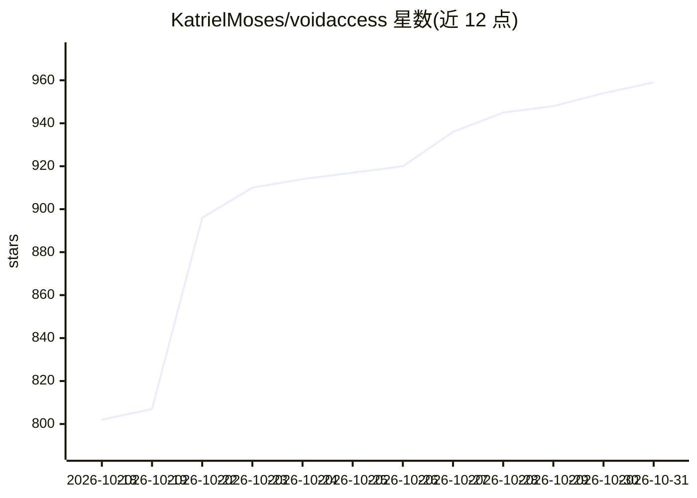

# KatrielMoses/voidaccess

⭐ 959 · Python · MIT · 推送 2026-10-29 · [GitHub](https://github.com/KatrielMoses/voidaccess) · [官网](https://voidaccess.pro) · 个人维护

**自托管暗网 OSINT 平台：一次查询产出报告、图谱与 IOC**

面向安全研究者、威胁情报团队与 MSSP 的开源暗网情报工具。单条查询并行分发至 12+ 个 Tor 搜索引擎、代码托管平台、安全订阅源与 .onion 种子，经安全门过滤后抽取威胁行为体、基础设施、加密钱包、凭证、通讯渠道与漏洞实体，构建可检索的关系图谱，并支持 STIX 2.1、MISP、YARA 等 9 种导出格式。LLM 为可选富化组件，支持 OpenRouter/Groq/OpenAI/Anthropic/Gemini/Ollama 等提供商，可用 --no-llm --no-tor 走纯明网流程。提供 pip 安装的 CLI 与 Docker Compose 全栈自托管两种方式。

## 筛选速览

| 维度 | 判定 | 备注 |
|---|---|---|
| AI 角色 | `ai-enhanced` | 去掉 AI 部分产品仍成立 |
| 许可风险 | `permissive` | MIT |
| 部署形态 | `self-host` | docker 或自建部署 |
| 模型依赖 | local-ok | 支持本地模型 |
| 硬件要求 | — | 无带数字的原话,不猜 |
| 安装摩擦 | `low` | 无编译、无系统依赖或容器化 |
| 成熟度 | — | 结构信号不足 |

## 能力要点

- 单查询并行分发至 12+ Tor 搜索引擎与 .onion 种子并跟踪新链接
- 抽取威胁行为体/基础设施/钱包/凭证/通讯/漏洞六类实体并构建关系图谱
- 9 种导出格式：STIX 2.1、MISP、Sigma、YARA、Snort、Suricata、CSV、JSON、Markdown
- LLM 提供商可配置（OpenRouter/Groq/OpenAI/Anthropic/Gemini/Ollama），可 --no-llm 纯明网运行

## 适用场景

- 对勒索软件团伙等威胁行为体开展授权暗网调查
- 将调查结果以 STIX/MISP 等格式导入现有安全工作流
- 在隔离环境用本地 Ollama 模型做情报富化
- MSSP 或团队通过 Docker Compose 自托管全套平台

## 场景标签

`网络安全` `知识图谱` `网页抓取` · 领域:效率与自动化

## 证据(README 行号)

> L9:  Ask one question. Get a sourced report, a graph you can search, and IOCs you can load.
> L10:  For security researchers, threat-intel teams, MSSPs and authorized investigators.
> L30: One query fans out in parallel to 12+ Tor search engines, code hosts, security feeds and curated `.onion` seeds, th
> L58: No Tor or LLM key yet? `voidaccess investigate "LockBit ransomware" --no-llm --no-tor --depth shallow` runs a clear

## 星数曲线

2026-10-18 802 → 2026-10-31 959（+157）

---
*卡片 v1 · prompt 1.4 · 生成 2026-10-21 · 置信度 high · 依据 README sha `bdb406040305` · [字段定义](../../DATASET.md)*
