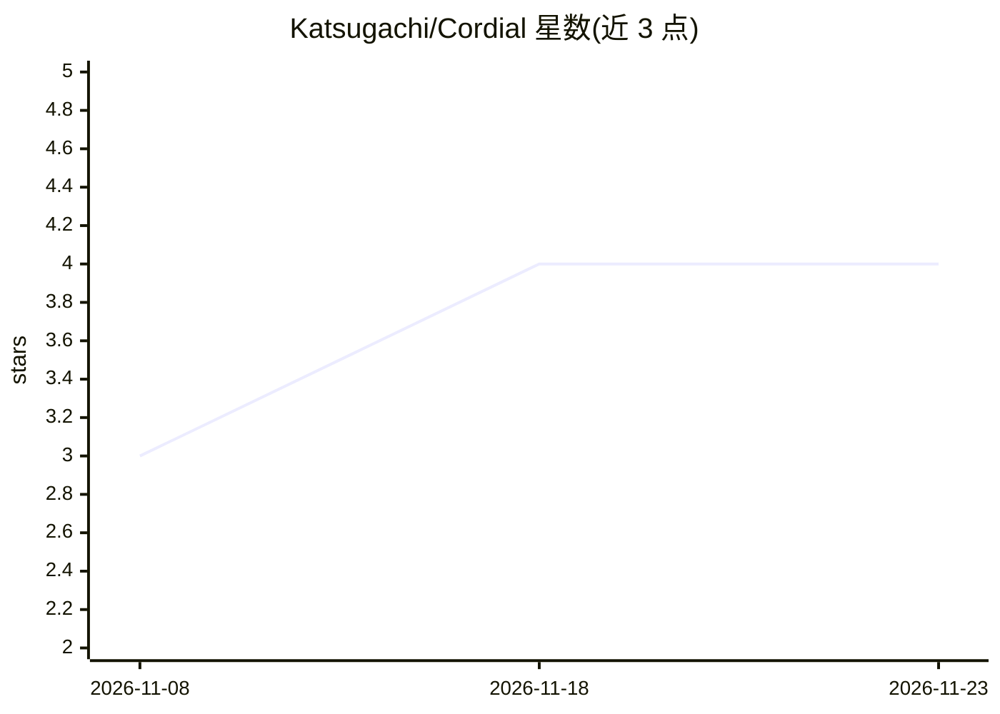

# Katsugachi/Cordial

⭐ 4 · Rust · NOASSERTION · 推送 2026-11-13 · [GitHub](https://github.com/Katsugachi/Cordial) · [官网](https://katsugachi.github.io/Cordial/) · 个人维护

**本地运行的桌面 AI 助手，提供浏览器操作与图像理解**

以 Rust/Tauri 为外壳的桌面应用，内置本地 agent 运行环境，运行 LFM3-VL-2B 模型（通过 llama.cpp 静态构建）。首次启动下载约 1.3 GB 模型权重与视觉投影器，之后仅在网络工具被调用时联网。提供带来源引用的问答、基于 Chrome DevTools Protocol 的浏览器工具（打开/点击/输入/查看，返回页面文本与截图）、图像与文本文件输入、沙盒工作区内文件读写，以及 Auto/Manual 两级权限确认机制。支持 macOS/Windows/Linux 安装包与源码构建。

## 筛选速览

| 维度 | 判定 | 备注 |
|---|---|---|
| AI 角色 | `ai-native` | 本体是模型或模型工具 |
| 许可风险 | `none` | NOASSERTION |
| 部署形态 | `desktop` | 安装包/桌面程序 |
| 模型依赖 | — | README 未给出锁定关系 |
| 硬件要求 | — | 无带数字的原话,不猜 |
| 安装摩擦 | `medium` | 含编译或系统依赖之一 |
| 成熟度 | — | 结构信号不足 |

## 能力要点

- 本地运行 LFM3-VL-2B（2B 视觉模型），首次启动后可离线使用
- 基于 Chrome DevTools Protocol 的浏览器自动化工具，返回页面文本与截图
- Auto/Manual 两种权限模式，工具调用可逐条批准或拒绝
- 三档 Effort 设置限制工具轮次与输出 token 数

## 适用场景

- 在本地桌面向 AI 提问并要求附带来源链接
- 让 agent 代为浏览网页、点击操作并查看页面截图
- 向模型发送图片或文本文件并让其读取工作区文件
- 无遥测、无账号的私有化本地 AI 使用环境

## 场景标签

`AI 助手` `浏览器自动化` · 领域:效率与自动化

## 证据(README 行号)

> L3: A lightweight, ultra-fast local AI agent and private desktop assistant. Runs LFM3-VL-2B via llama.cpp with native br
> L5: Cordial is a desktop app: a thin Rust/Tauri shell around a local agentic harness.
> L14: - **Answers with sources. (most of the time)** The system prompt pushes the model to search before it

## 星数曲线

2026-11-08 3 → 2026-11-23 4（+1）

---
*卡片 v1 · prompt 1.4 · 生成 2026-11-21 · 置信度 high · 依据 README sha `e206c53b356f` · [字段定义](../../DATASET.md)*
