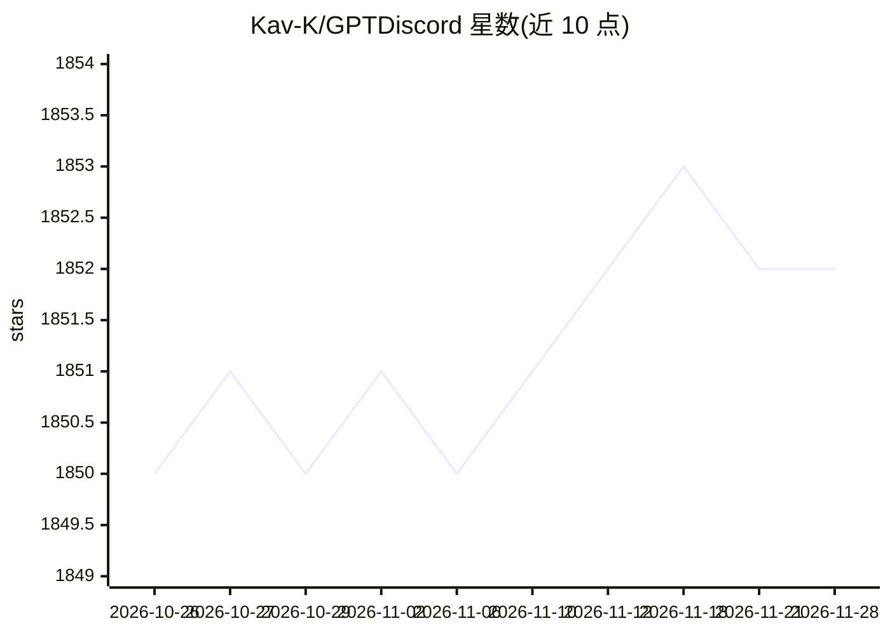

# Kav-K/GPTDiscord

⭐ 1,852 · Python · MIT · 推送 2026-11-01 · [GitHub](https://github.com/Kav-K/GPTDiscord) · 个人维护

**在 Discord 中提供 GPT 聊天、图像生成与转录的机器人**

以 Python 编写的 Discord 机器人，通过斜杠命令提供 Chat Completions 对话、图像生成、语音转录、内容审核与网页搜索结果。基础安装仅需 FFmpeg，可选集成文档索引、Google 搜索、Pinecone/Qdrant 记忆、E2B 代码执行与 Replicate 视觉回退，各集成用 pip extras 分开安装。通过 OPENAI_API_KEY、DISCORD_TOKEN 等环境变量配置，支持按 Discord 角色 ID 限制访问，并可用 OPENAI_BASE_URL 接入兼容端点。

## 筛选速览

| 维度 | 判定 | 备注 |
|---|---|---|
| AI 角色 | `ai-native` | 本体是模型或模型工具 |
| 许可风险 | `permissive` | MIT |
| 部署形态 | `self-host` | docker 或自建部署 |
| 模型依赖 | — | README 未给出锁定关系 |
| 硬件要求 | — | 无带数字的原话,不猜 |
| 安装摩擦 | `low` | 无编译、无系统依赖或容器化 |
| 成熟度 | — | 结构信号不足 |

## 能力要点

- /gpt ask、/gpt converse 支持含视觉与推理模型的 Chat Completions
- /web 支持 Parallel 源摘录（免 API key）与 OpenAI 合成回答两种 provider
- 可选 pip extras：索引、搜索、Pinecone、Qdrant、E2B、Replicate
- BOT_ACCESS_ROLE_IDS 基于角色 ID 的访问限制机制

## 适用场景

- 在 Discord 服务器里与 GPT 模型对话并生成图像
- 为服务器配置基于角色的 bot 使用权限
- 索引 GitHub 仓库或 YouTube 字幕做文档问答
- 用 Pinecone 或 Qdrant 持久化对话记忆

## 场景标签

`聊天机器人` `图像生成` `文档问答` · 领域:对话与助手

## 证据(README 行号)

> L7: OpenAI chat, vision, image generation, transcription, moderation, and web search in Discord. Python **3.11–3.13** is
> L11: - `/gpt ask` and `/gpt converse` use current Chat Completions models, including vision and reasoning models. Defaul

## 星数曲线

2026-10-26 1,850 → 2026-11-28 1,852（+2）

---
*卡片 v1 · prompt 1.4 · 生成 2026-11-23 · 置信度 high · 依据 README sha `4bea72c15716` · [字段定义](../../DATASET.md)*
