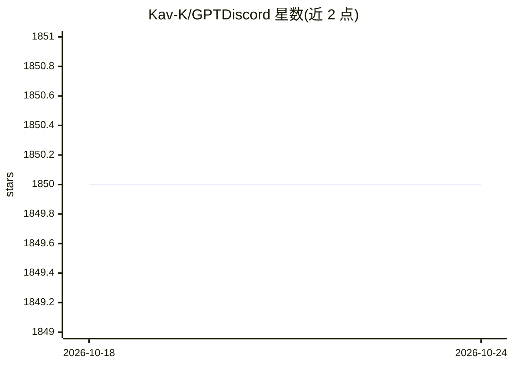

# Kav-K/GPTDiscord

⭐ 1,850 · Python · MIT · 推送 2026-10-18 · [GitHub](https://github.com/Kav-K/GPTDiscord) · 个人维护

**在 Discord 中提供 OpenAI 对话、图像生成与审核的机器人**

基于 Python 3.11–3.13 的 Discord 机器人，通过斜杠命令提供 OpenAI 聊天（含视觉与推理模型）、Responses API 网络搜索、GPT Image 图像生成、语音转录与审核。支持长对话、按用户 API key、服务器角色限制与对话投递恢复。可选集成包括文档索引问答（GitHub/YouTube 阅读）、Qdrant/Pinecone 记忆、E2B 代码执行、DeepL 翻译与 Replicate 视觉。需自备 OpenAI 与 Discord token，可用 pip、Docker Compose 或源码运行。

## 筛选速览

| 维度 | 判定 | 备注 |
|---|---|---|
| AI 角色 | `ai-native` | 本体是模型或模型工具 |
| 许可风险 | `permissive` | MIT |
| 部署形态 | `self-host` | docker 或自建部署 |
| 模型依赖 | — | README 未给出锁定关系 |
| 硬件要求 | — | 无带数字的原话,不猜 |
| 安装摩擦 | `low` | 无编译、无系统依赖或容器化 |
| 成熟度 | — | 结构信号不足 |

## 能力要点

- 斜杠命令覆盖聊天、视觉、网络搜索、图像生成与转录
- 文档索引问答，可读取 GitHub 仓库、YouTube 字幕与上传媒体
- Qdrant/Pinecone 可选记忆与按用户的 API key 隔离
- 角色级访问限制与对话投递恢复（REST 轮询）

## 适用场景

- 在 Discord 服务器里与 GPT 进行多轮对话和联网问答
- 对服务器文档/YouTube 视频建索引并提问
- 按角色控制谁能使用机器人的各项 AI 功能

## 场景标签

`聊天机器人` `图像生成` `文档问答` `语音识别` · 领域:对话与助手

## 证据(README 行号)

> L7: OpenAI chat, vision, image generation, transcription, moderation, and web search in Discord. Python **3.11–3.13** is
> L11: - `/gpt ask` and `/gpt converse` use current Chat Completions models, including vision and reasoning models. Defaul
> L13: - `/dalle draw` keeps the familiar command name and generates images with the current **GPT Image** API. Image byte

## 星数曲线

2026-10-18 1,850 → 2026-10-24 1,850（+0）

---
*卡片 v1 · prompt 1.4 · 生成 2026-10-21 · 置信度 high · 依据 README sha `7a7773854936` · [字段定义](../../DATASET.md)*
