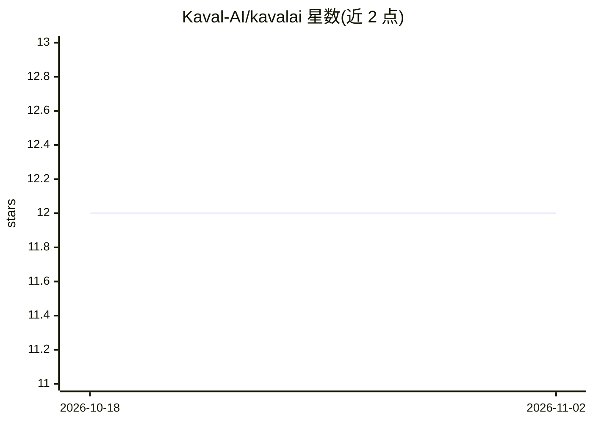

# Kaval-AI/kavalai

⭐ 12 · Python · Apache-2.0 · 推送 2026-10-02 · [GitHub](https://github.com/Kaval-AI/kavalai) · [官网](http://docs.kaval.ai/) · 组织维护

**构建类型化、可测试 agentic 工作流的 Python 库**

面向开发者的 Python 库，用于构建 agentic 工作流、聊天机器人与工具：以统一接口调用 OpenAI、Google、Anthropic、Ollama 及浏览器内 WebLLM 等模型；输入输出与工具调用均为 Pydantic 模型；内置基于 SQLite 或 PostgreSQL/pgvector 的 RAG；工作流以图形式定义，支持条件路由与并行分发，可用 Python 或 YAML 编写；提供会话/运行/节点级记录与 Backoffice UI 观测调试。通过 pip 安装，Apache 2.0 许可。

## 筛选速览

| 维度 | 判定 | 备注 |
|---|---|---|
| AI 角色 | `ai-ecosystem` | LLM/agent 周边工具 |
| 许可风险 | `permissive` | Apache-2.0 |
| 部署形态 | `library` | 以包/库形式分发 |
| 模型依赖 | local-ok | 支持本地模型 |
| 硬件要求 | — | 无带数字的原话,不猜 |
| 安装摩擦 | `low` | 无编译、无系统依赖或容器化 |
| 成熟度 | — | 结构信号不足 |

## 能力要点

- 统一接口接入 OpenAI/Google/Anthropic/Ollama/WebLLM
- Pydantic 类型化的输入输出与工具调用
- 内置 SQLite/PostgreSQL(pgvector) RAG 与本地或托管嵌入
- Python/YAML 图式工作流（条件路由、并行分发）与 Backoffice 观测 UI

## 适用场景

- 用一套代码接入多家模型厂商构建聊天机器人
- 为 agent 工作流做类型化定义与测试
- 搭建带检索增强与观测 UI 的问答机器人

## 场景标签

`Agent 框架` `RAG` · 领域:Agent 开发

## 证据(README 行号)

> L5: Kaval.AI is an opinionated Python library for building well-defined, testable and robust
> L16: - **Workflows as graphs** — conditional routing, parallel fan-out, agents and
> L43: Name a model as `provider/model` and `make_client` does the rest.

## 星数曲线

2026-10-18 12 → 2026-11-02 12（+0）

---
*卡片 v1 · prompt 1.4 · 生成 2026-11-01 · 置信度 high · 依据 README sha `78998bb8a376` · [字段定义](../../DATASET.md)*
