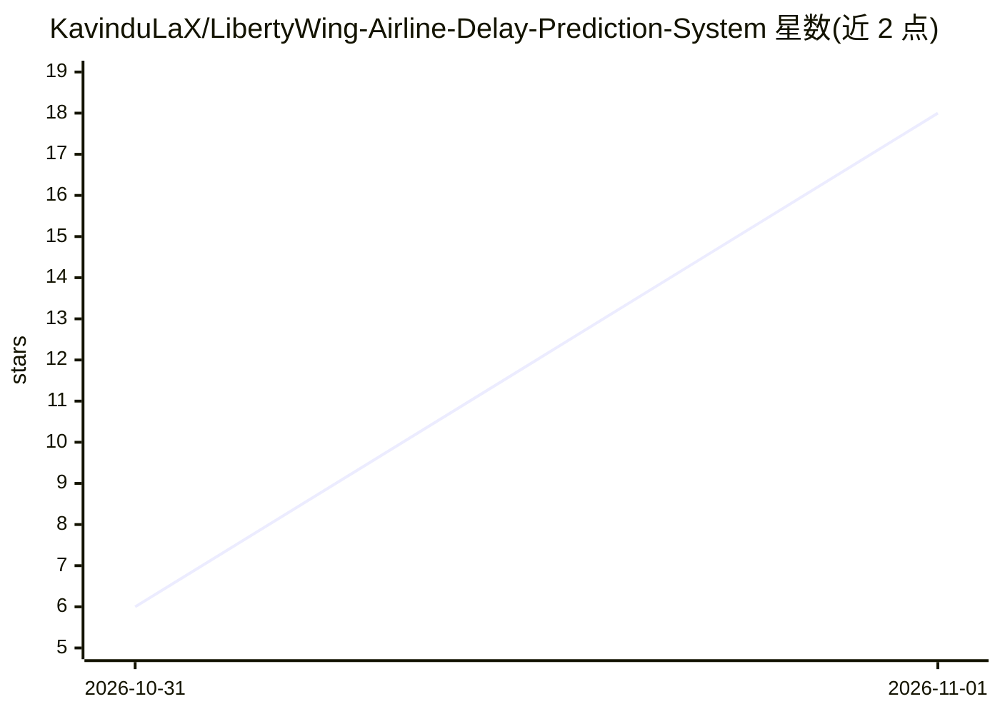

# KavinduLaX/LibertyWing-Airline-Delay-Prediction-System

⭐ 18 · CSS · MIT · 推送 2026-10-30 · [GitHub](https://github.com/KavinduLaX/LibertyWing-Airline-Delay-Prediction-System) · 组织维护

**大学课程项目：预测航班是否延误超15分钟的全栈 Web 应用**

机器学习驱动的航班延误预测系统：基于类加权梯度提升分类器，使用九个特征（航空公司、起降机场、时段、星期、航距等）预测航班是否会出现 15 分钟以上的显著离港延误，并输出延误概率。后端为 Flask REST API 加载已训练的 .pkl 模型，前端为 React/Vite 交互界面，另含航班对比与探索性数据分析界面。README 报告准确率 55.42%、精确率 14.67%，明确指出存在较多误报，预测仅为估计值，且面向本地开发而非生产部署。属 IT3051 数据挖掘课程的团队项目。

## 筛选速览

| 维度 | 判定 | 备注 |
|---|---|---|
| AI 角色 | `ai-native` | 本体是模型或模型工具 |
| 许可风险 | `permissive` | MIT |
| 部署形态 | `library` | 以包/库形式分发 |
| 模型依赖 | — | README 未给出锁定关系 |
| 硬件要求 | — | 无带数字的原话,不猜 |
| 安装摩擦 | `low` | 无编译、无系统依赖或容器化 |
| 成熟度 | — | 结构信号不足 |

## 能力要点

- 类加权梯度提升分类器预测 15 分钟以上离港延误并输出概率
- Flask REST API（POST /predict）+ React/Vite 前端全栈集成
- 九特征管道，后端自动从日期时间派生特征
- 含航班对比与探索性数据分析界面

## 适用场景

- 输入航班信息查看延误概率估计
- 学习数据预处理、特征工程、分类与全栈集成的完整流程
- 作为课程/教学项目参考实现

## 场景标签

 · 领域:数据科学/预测分析

## 证据(README 行号)

> L9: A machine learning-powered web application for predicting significant airline departure delays using a Gradient Boos
> L15: The application predicts whether a flight is likely to experience a significant departure delay of 15 minutes or mo

## 星数曲线

2026-10-31 6 → 2026-11-01 18（+12）

---
*卡片 v1 · prompt 1.4 · 生成 2026-10-31 · 置信度 high · 依据 README sha `ad69caa9ba51` · [字段定义](../../DATASET.md)*
