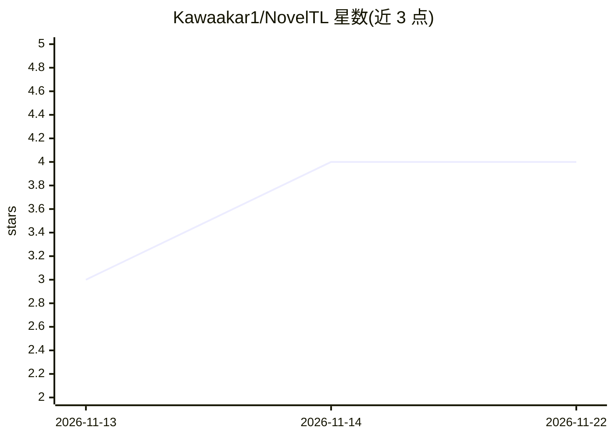

# Kawaakar1/NovelTL

⭐ 4 · Rust · GPL-3.0 · 推送 2026-11-20 · [GitHub](https://github.com/Kawaakar1/NovelTL) · [官网](https://kawaakar1.github.io/NovelTL/) · 个人维护

**给视觉小说玩家的实时游戏内翻译覆盖层**

面向 Windows/Linux 玩家的视觉小说翻译工具：通过 LunaHook 文本钩取或 OCR（或剪贴板模式）捕获游戏对白，在游戏窗口上方半透明浮层显示译文，支持日/英/中/韩/俄互译。翻译通道包括 Google（免密钥）、DeepL（API key）、Microsoft Translator 及本地模型（Ollama/LM Studio）。面向日语学习者提供振假名、JMdict 词典查询与 Anki 卡片导出（AnkiConnect）。以 Rust 编写的单 exe 提供，安装包约 6 MB；主要针对 YUZUSOFT/KiriKiri 引擎游戏。

## 筛选速览

| 维度 | 判定 | 备注 |
|---|---|---|
| AI 角色 | `ai-native` | 本体是模型或模型工具 |
| 许可风险 | `viral` | GPL-3.0 |
| 部署形态 | `desktop` | 安装包/桌面程序 |
| 模型依赖 | local-ok | 支持本地模型 |
| 硬件要求 | — | 无带数字的原话,不猜 |
| 安装摩擦 | `low` | 无编译、无系统依赖或容器化 |
| 成熟度 | — | 结构信号不足 |

## 能力要点

- LunaHook 文本钩取、OCR 与剪贴板三种文本捕获方式
- Google/DeepL/Microsoft Translator/Ollama/LM Studio 多翻译通道
- 振假名显示、JMdict 词典与 AnkiConnect 卡片导出
- 游戏库、阅读日历、统计与自定义浮层样式

## 适用场景

- 边玩日语视觉小说边看实时中文/俄文翻译
- 借助振假名和词典查询学习日语
- 离线环境下用本地模型翻译游戏对白

## 场景标签

`OCR` · 领域:感知与多模态

## 证据(README 行号)

> L5: **Переводчик визуальных новелл для Windows — перевод прямо поверх игры**
> L34: - 🆓 **Бесплатные варианты.** Локальный ИИ (Ollama, LM Studio) без интернета и Microsoft Translator (2 млн символов 

## 星数曲线

2026-11-13 3 → 2026-11-22 4（+1）

---
*卡片 v1 · prompt 1.4 · 生成 2026-11-21 · 置信度 high · 依据 README sha `d9832faafeea` · [字段定义](../../DATASET.md)*
