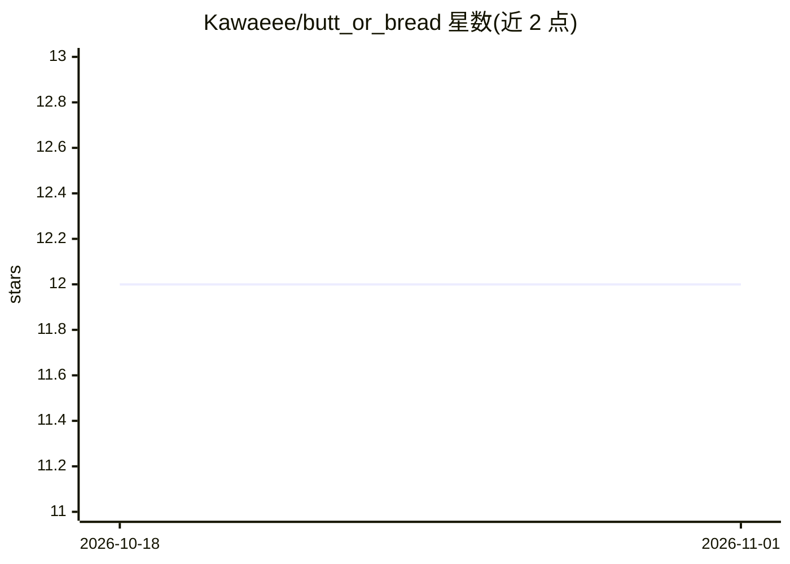

# Kawaeee/butt_or_bread

⭐ 12 · Jupyter Notebook · MIT · 推送 2026-06-11 · [GitHub](https://github.com/Kawaeee/butt_or_bread) · [官网](https://bob-or-bread.streamlit.app/) · 个人维护

**柯基屁股 vs 面包辨别的图像分类项目（PyTorch+Streamlit）**

作者出于趣味开发的二分类深度学习模型：判断图片是柯基犬臀部还是一条面包。基于 ResNet-152，用 PyTorch 在 Google Colaboratory GPU 上训练；数据集合并 Google Open Images V5、ImageNet、Stanford Dogs 与 Google 图片搜索结果（6385 张，人工清洗并 phash 去重），测试准确率 0.9968。提供模型权重下载、train.py 复现训练、predictor.ipynb 交互预测，以及 Streamlit 本地/Docker 两种 Web 演示方式。数据集需邮件联系作者获取。

## 筛选速览

| 维度 | 判定 | 备注 |
|---|---|---|
| AI 角色 | `ai-native` | 本体是模型或模型工具 |
| 许可风险 | `permissive` | MIT |
| 部署形态 | `self-host` | docker 或自建部署 |
| 模型依赖 | — | README 未给出锁定关系 |
| 硬件要求 | — | 无带数字的原话,不猜 |
| 安装摩擦 | `low` | 无编译、无系统依赖或容器化 |
| 成熟度 | — | 结构信号不足 |

## 能力要点

- ResNet-152 二分类模型，测试集准确率 0.9968
- 6385 张图像数据集，人工清洗并用 phash 去重
- 提供 Streamlit Web 应用（本地与 Docker 两种运行方式）
- 提供模型权重下载与训练复现脚本

## 适用场景

- 上传图片判断是柯基屁股还是面包（娱乐用途）
- 复现训练流程学习 PyTorch 图像分类
- 参考其数据清洗与划分流程

## 场景标签

`目标检测` · 领域:感知与多模态

## 证据(README 行号)

> L6: * We have seen a popular meme that tries to represent the similarity shared between animals and food such as **"Shib
> L8: * We used the PyTorch framework with GPU to develop our model using Google Colaboratory.
> L30: - ResNet-152

## 星数曲线

2026-10-18 12 → 2026-11-01 12（+0）

---
*卡片 v1 · prompt 1.4 · 生成 2026-11-01 · 置信度 high · 依据 README sha `e1a729644549` · [字段定义](../../DATASET.md)*
