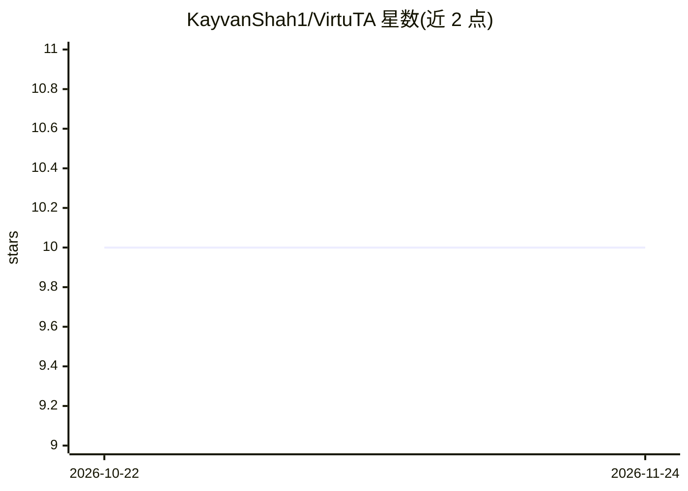

# KayvanShah1/VirtuTA

⭐ 10 · Python · MIT · 推送 2026-03-03 · [GitHub](https://github.com/KayvanShah1/VirtuTA) · 组织维护

**面向大学课程的 AI 助教：自动回答 Piazza 学生提问**

面向大学课程的虚拟助教项目：通过 Piazza API 拉取未回答的提问，基于 Langchain 构建的多模态 RAG 流程与 Google Gemini 生成回答，答案可包含幻灯片截图、视频时间戳与来源链接；使用 Mongo Atlas Vector Search 维护内容类与课程事务类两个向量库，内容类查询还会调用 YouTube API 检索讲解视频。除答疑外还覆盖作业管理、课程资料上传与学生互动分析等功能。README 注明该项目目前不被维护，仅供教学演示用途。

## 筛选速览

| 维度 | 判定 | 备注 |
|---|---|---|
| AI 角色 | `ai-native` | 本体是模型或模型工具 |
| 许可风险 | `permissive` | MIT |
| 部署形态 | `None` |  |
| 模型依赖 | — | README 未给出锁定关系 |
| 硬件要求 | — | 无带数字的原话,不猜 |
| 安装摩擦 | `low` | 无编译、无系统依赖或容器化 |
| 成熟度 | — | 结构信号不足 |

## 能力要点

- 基于 Langchain + Google Gemini 的多模态 RAG 工作流
- 通过 Piazza API 自动检索未解决问题并在帖子中直接作答
- Mongo Atlas Vector Search 双向量库区分内容类与事务类查询
- 回答附带幻灯片快照、视频时间戳与来源链接

## 适用场景

- 在 Piazza 课程论坛自动回答学生的概念性提问
- 自动响应选课、截止日期等课程事务类问题
- 上传课程材料供学生随时检索查阅

## 场景标签

`RAG` `多模态` · 领域:知识与检索

## 证据(README 行号)

> L1: # VirtuTA: AI-enabled Virtual Teaching Assistant
> L43: We have created a `multimodal RAG` using `Langchain`, powered by `Google Gemini`. For __context awareness__, we uti
> L45: This agentic workflow is directly integrated into `Piazza,` a popular forum students and teachers at many universit

## 星数曲线

2026-10-22 10 → 2026-11-24 10（+0）

---
*卡片 v1 · prompt 1.4 · 生成 2026-11-20 · 置信度 high · 依据 README sha `0398581331c5` · [字段定义](../../DATASET.md)*
