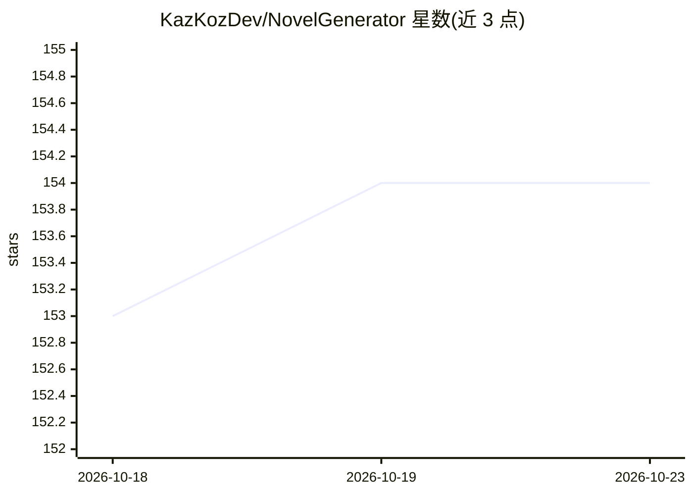

# KazKozDev/NovelGenerator

⭐ 154 · TypeScript · NOASSERTION · 推送 2026-10-09 · [GitHub](https://github.com/KazKozDev/NovelGenerator) · 个人维护

**本地 AI 长篇小说生成器：从一段前提逐章写出全书**

基于浏览器的源码可得（BSL 1.1）AI 小说写作应用：输入一段前提，引擎先构建人物、世界观、因果地图与章节规划，再逐章逐场景写作。机制包括持续故事记忆（每场景变更须引用段落佐证）、场景交接与再定位、矛盾检测重写、书末审计，支持导出 EPUB/PDF/TXT/Markdown。模型后端可选 Gemini API 或本地 Ollama，可分设 writer/editor 双模型。稿件存于 IndexedDB，关闭页面可续写。限制：仅 macOS 验证，无 CI，模型须支持 JSON Schema 输出。

## 筛选速览

| 维度 | 判定 | 备注 |
|---|---|---|
| AI 角色 | `ai-native` | 本体是模型或模型工具 |
| 许可风险 | `none` | NOASSERTION |
| 部署形态 | `library` | 以包/库形式分发 |
| 模型依赖 | local-ok | 支持本地模型 |
| 硬件要求 | — | 无带数字的原话,不猜 |
| 安装摩擦 | `low` | 无编译、无系统依赖或容器化 |
| 成熟度 | — | 结构信号不足 |

## 能力要点

- 前提→设计→章节规划→场景→交接→审计的完整流水线
- 持续故事记忆：每条记录须引用证明段落，引用无效则重试
- writer/editor 双模型分工，规划、审查与审计由 editor 承担
- 支持 Gemini 与本地 Ollama，可分设写作与编辑模型

## 适用场景

- 把我的一段故事前提扩写成多章节长篇小说
- 用本地 Ollama 模型离线、私密地生成小说
- 检查并导出带连续性审计的成稿（EPUB/PDF/TXT/MD）

## 场景标签

`AI 写作` · 领域:内容生成

## 证据(README 行号)

> L3: NovelGenerator is a source-available AI novel writer that turns a one-paragraph premise
> L4: into a full manuscript, chapter by chapter. Run it with Gemini or use Ollama as a local AI
> L37: scene by scene without asking you to approve anything mid-run. Export the finished book as

## 星数曲线

2026-10-18 153 → 2026-10-23 154（+1）

---
*卡片 v1 · prompt 1.4 · 生成 2026-10-22 · 置信度 high · 依据 README sha `94583c5b7a65` · [字段定义](../../DATASET.md)*
