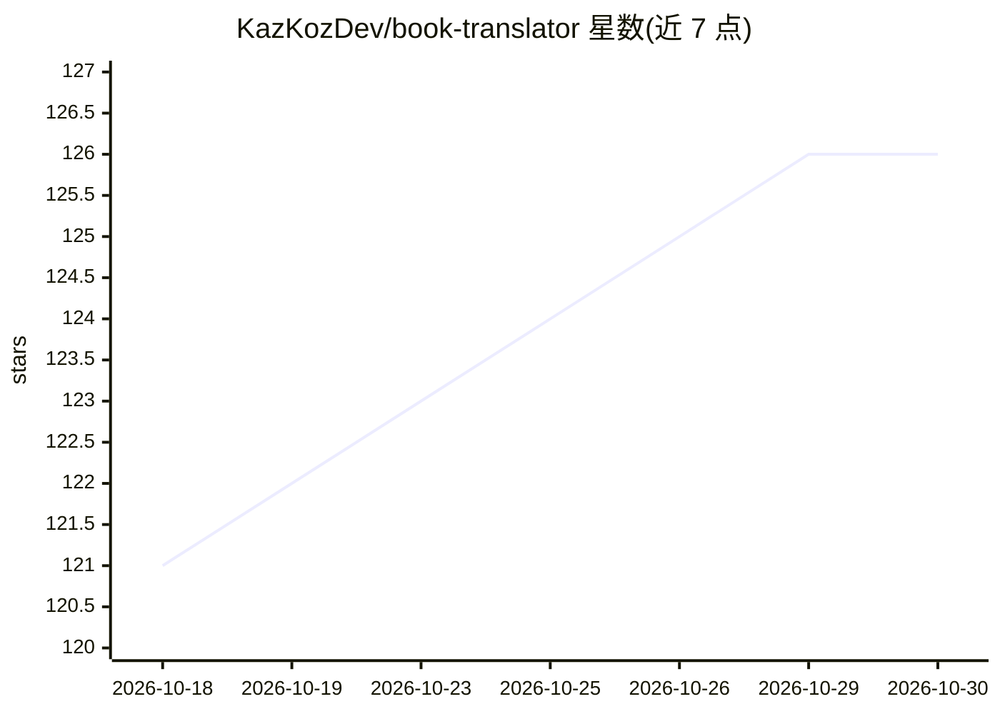

# KazKozDev/book-translator

⭐ 126 · Python · AGPL-3.0 · 推送 2026-10-11 · [GitHub](https://github.com/KazKozDev/book-translator) · 个人维护

**本地整书 AI 翻译应用：用 Ollama 把 EPUB/PDF/DOCX 译成完整书**

基于 Ollama 的开源图书翻译 Web 应用：上传 TXT/EPUB/PDF/DOCX，先用 GLiNER 与 BGE-M3 从全书构建术语表，再按约 1200 字符分块翻译，精炼模型提出局部修改并由独立校验模型核对后落稿，最后在对照审校台导出 TXT/PDF/EPUB。支持本地模型或 Ollama Cloud，数据存于本地 SQLite；限制包括 PDF 不保留版式、整书需 10–15 小时且需配置多种角色的模型。通过 git clone 与启动脚本安装，需 Python 3.10+ 与 Ollama。

## 筛选速览

| 维度 | 判定 | 备注 |
|---|---|---|
| AI 角色 | `ai-native` | 本体是模型或模型工具 |
| 许可风险 | `viral` | AGPL-3.0 |
| 部署形态 | `library` | 以包/库形式分发 |
| 模型依赖 | local-ok | 支持本地模型 |
| 硬件要求 | — | 无带数字的原话,不猜 |
| 安装摩擦 | `low` | 无编译、无系统依赖或容器化 |
| 成熟度 | — | 结构信号不足 |

## 能力要点

- 全书级术语表（exact/inflectable/preferred 规则）跨章节保持人名地名一致
- 精炼-校验双模型流程：每处局部修改先与原文核对再应用
- 来源/初稿/终稿三栏对照审校台，支持暂停恢复与任务归档
- 确定性质检（数字变更、术语违规、回译 chrF、LaBSE、COMET-Kiwi 可选）

## 适用场景

- 把整本外文小说离线翻译成母语并导出 EPUB
- 翻译时锁住人名、地名与术语保持全书一致
- 对敏感书稿在本地模型上完成翻译，不外发文本

## 场景标签

 · 领域:翻译/电子书工具

## 证据(README 行号)

> L4:  Open-source AI book translator powered by Ollama, with local models or Ollama Cloud.
> L51: Upload → Prepare → Start → Continue → Review → Download
> L63: Then open the **Review desk**: source, first draft, and editable final text side by side. Export to **TXT, PDF, or 

## 星数曲线

2026-10-18 121 → 2026-10-30 126（+5）

---
*卡片 v1 · prompt 1.4 · 生成 2026-10-23 · 置信度 mid · 依据 README sha `0644ea2a0c42` · [字段定义](../../DATASET.md)*
