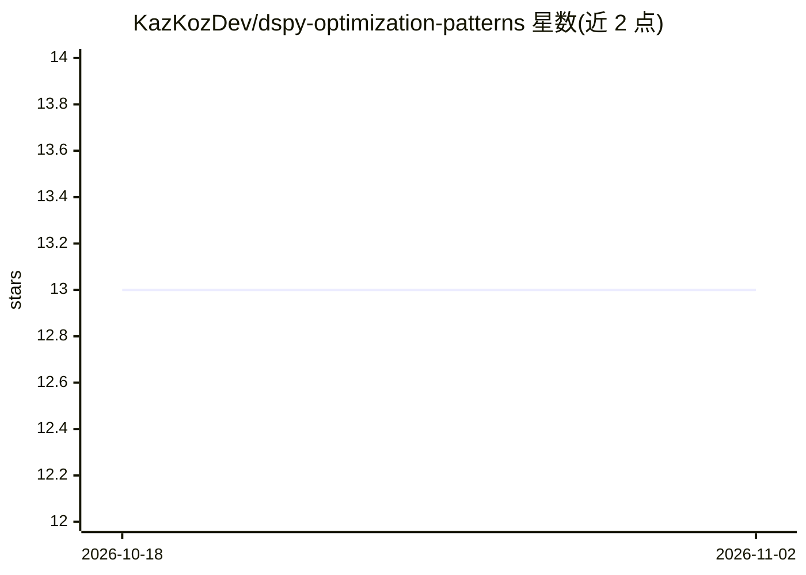

# KazKozDev/dspy-optimization-patterns

⭐ 13 · HTML · MIT · 推送 2026-03-21 · [GitHub](https://github.com/KazKozDev/dspy-optimization-patterns) · 个人维护

**DSPy 生产化框架：教师-学生工作流编译、版本化并服务 LLM 程序**

面向构建 RAG、QA 或分类系统的团队，将 DSPy 程序作为可部署资产处理：准备数据、用更强的教师模型运行优化、将编译结果保存为版本化 JSON 工件，再由 FastAPI 服务在启动时加载工件，用更便宜的学生模型对外提供 /qa、/rag、/classify 等推理端点。包含 Phoenix 可观测性、Docker Compose 与 Kubernetes 部署清单、pytest 覆盖与示例脚本。使用 Poetry 管理依赖，多数流程需配置 OPENAI_API_KEY。

## 筛选速览

| 维度 | 判定 | 备注 |
|---|---|---|
| AI 角色 | `ai-ecosystem` | LLM/agent 周边工具 |
| 许可风险 | `permissive` | MIT |
| 部署形态 | `self-host` | docker 或自建部署 |
| 模型依赖 | — | README 未给出锁定关系 |
| 硬件要求 | — | 无带数字的原话,不猜 |
| 安装摩擦 | `low` | 无编译、无系统依赖或容器化 |
| 成熟度 | — | 结构信号不足 |

## 能力要点

- 教师-学生模型配置分离优化成本与推理成本
- 编译产物保存为版本化工件并在服务启动时加载
- FastAPI 暴露 /qa、/rag、/classify、/health、/artifacts 端点
- 提供 Docker Compose、Kubernetes 清单与 Phoenix 可观测性

## 适用场景

- 把 DSPy 优化流程沉淀为可复现、可版本化的部署工件
- 用强模型离线优化、弱模型在线服务以降低推理成本
- 为 RAG/QA/分类系统搭建从优化到在线服务的流水线

## 场景标签

`RAG` `MLOps` `LLM 可观测性` `提示工程` · 领域:Agent 开发

## 证据(README 行号)

> L5: Production-oriented DSPy starter for compiling, serving, and operating LLM programs with a teacher-student workflow.
> L30: Most LLM applications stop at prompt iteration, which makes behavior hard to reproduce, version, and deploy. DSPy c

## 星数曲线

2026-10-18 13 → 2026-11-02 13（+0）

---
*卡片 v1 · prompt 1.4 · 生成 2026-10-31 · 置信度 high · 依据 README sha `36fb4b46e04b` · [字段定义](../../DATASET.md)*
