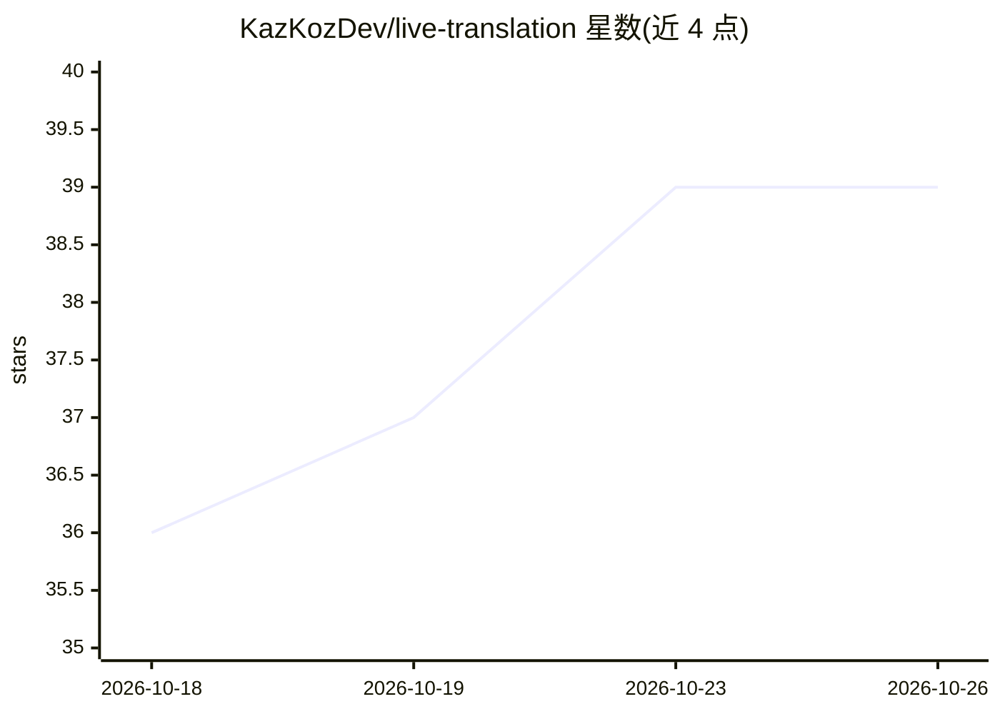

# KazKozDev/live-translation

⭐ 39 · Python · MIT · 推送 2026-10-04 · [GitHub](https://github.com/KazKozDev/live-translation) · 个人维护

**macOS 本地实时系统音频字幕+翻译应用**

面向 Apple silicon Mac 用户的离线实时字幕与翻译工具：通过 BlackHole 捕获系统音频，用 MLX Whisper 转录、Silero VAD 做语音检测与无损分段，再由经 Ollama 运行的 Gemma 4 模型做句子级翻译，原文与译文在 PyObjC 悬浮玻璃层并排显示。全程本地运行，无需 API key。限制：仅支持 Apple silicon 与 macOS 14+，需手动配置 BlackHole 多输出设备，Whisper 偶发幻觉。通过 setup.sh 或手动 venv 安装，也可安装为 macOS 应用。

## 筛选速览

| 维度 | 判定 | 备注 |
|---|---|---|
| AI 角色 | `ai-native` | 本体是模型或模型工具 |
| 许可风险 | `permissive` | MIT |
| 部署形态 | `library` | 以包/库形式分发 |
| 模型依赖 | local-ok | 支持本地模型 |
| 硬件要求 | — | 无带数字的原话,不猜 |
| 安装摩擦 | `low` | 无编译、无系统依赖或容器化 |
| 成熟度 | — | 结构信号不足 |

## 能力要点

- BlackHole 系统级音频捕获 + MLX Whisper 转录 + Ollama Gemma 4 句子级翻译
- Silero VAD 无损分段：重叠分段、去重、重建完整句子
- 悬浮双语玻璃覆盖层，原文译文并排显示
- 完全本地离线运行，无需 API key 或云服务

## 适用场景

- 看外语影片、YouTube、直播时获得实时字幕和翻译
- 语言学习者对照真实语音的原文与译文
- 参加半懂语言会议通话时获取字幕
- 为无字幕音频提供无障碍字幕

## 场景标签

`语音识别` · 领域:感知与多模态

## 证据(README 行号)

> L3: A macOS app that captures any audio playing on your Mac — YouTube, Zoom, Twitch, livestreams, or any other app — tra
> L16: - MLX Whisper for transcription
> L17: - Gemma 4 through Ollama for translation

## 星数曲线

2026-10-18 36 → 2026-10-26 39（+3）

---
*卡片 v1 · prompt 1.4 · 生成 2026-10-25 · 置信度 mid · 依据 README sha `2fdb5e61cd79` · [字段定义](../../DATASET.md)*
