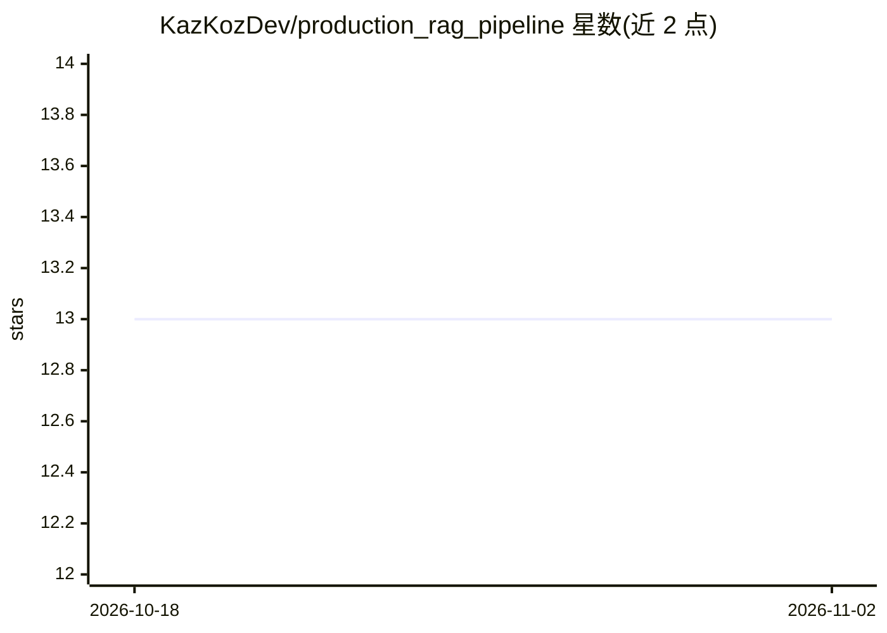

# KazKozDev/production_rag_pipeline

⭐ 13 · Python · MIT · 推送 2026-07-07 · [GitHub](https://github.com/KazKozDev/production_rag_pipeline) · 个人维护

**为本地 LLM 构建带引用的网络搜索管线，产出即用提示词**

Python 库，面向自托管小模型构建 Perplexity 式问答的搜索管线：并行检索 Bing 与 DuckDuckGo，抓取前用嵌入余弦相似度做语义预过滤，抓取后提取正文、按 BM25/语义/跨编码器重排，最终拼装带行内引用与当前时间的 LLM 提示词，可接入 Ollama、LM Studio 或任意 LLM API。支持俄/英自动语言检测与模型切换、新闻查询新鲜度惩罚、MMR 多样性控制；基础安装即可用词法回退运行，语义与 trafilatura 提取为可选 extras。通过 git clone + pip install . 安装，提供 Python API、CLI 与 macOS 启动脚本。

## 筛选速览

| 维度 | 判定 | 备注 |
|---|---|---|
| AI 角色 | `ai-ecosystem` | LLM/agent 周边工具 |
| 许可风险 | `permissive` | MIT |
| 部署形态 | `library` | 以包/库形式分发 |
| 模型依赖 | local-ok | 支持本地模型 |
| 硬件要求 | — | 无带数字的原话,不猜 |
| 安装摩擦 | `low` | 无编译、无系统依赖或容器化 |
| 成熟度 | — | 结构信号不足 |

## 能力要点

- Bing + DuckDuckGo 并行搜索并按位置合并结果
- 抓取前语义预过滤与两阶段价目/表格内容检测
- BM25、语义、MMR、可选跨编码器的多级重排
- 生成带行内引用与当前时间的 LLM 就绪提示词，支持 Python API/CLI/配置文件

## 适用场景

- 给本地 Ollama 或 LM Studio 模型接入带引用的联网搜索
- 搭建自托管的 Perplexity 式问答前端
- 对新闻类查询做时效性过滤与新鲜度标注

## 场景标签

`RAG` · 领域:知识与检索

## 证据(README 行号)

> L5: A library for building search pipelines for local LLMs that produce Perplexity-style answers, but self-hosted and wi
> L7: Searches Bing + DuckDuckGo, filters noise before fetching, extracts clean content, reranks by relevance, and outputs
> L67:  end-to-end orchestration: search → fetch → extract → rerank → context

## 星数曲线

2026-10-18 13 → 2026-11-02 13（+0）

---
*卡片 v1 · prompt 1.4 · 生成 2026-10-31 · 置信度 high · 依据 README sha `cc4394ad88a6` · [字段定义](../../DATASET.md)*
