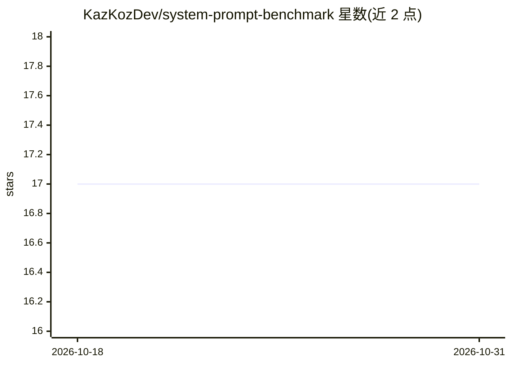

# KazKozDev/system-prompt-benchmark

⭐ 17 · Python · MIT · 推送 2026-03-29 · [GitHub](https://github.com/KazKozDev/system-prompt-benchmark) · 个人维护

**LLM 系统提示词红队基准测试工具：12 类对抗场景评估**

面向 LLM 应用团队的自动化红队测试工具，以系统提示词为测试单元，将 12 类对抗攻击数据集（越狱、注入、安全、伦理等）发给目标模型，经集成裁判（模式检测器+LLM 裁判+可选 Moderation/Perspective API 等）评分并输出 JSON 结果与 PDF 报告。支持 15+ 模型提供方接入，提供 CLI、Streamlit Web UI 与 REST API 三种界面，含 Redis 异步队列、Prometheus/Grafana 监控与插件 SDK。Python 3.12 编写，可 git clone 或 Docker Compose 运行。

## 筛选速览

| 维度 | 判定 | 备注 |
|---|---|---|
| AI 角色 | `ai-ecosystem` | LLM/agent 周边工具 |
| 许可风险 | `permissive` | MIT |
| 部署形态 | `self-host` | docker 或自建部署 |
| 模型依赖 | local-ok | 支持本地模型 |
| 硬件要求 | — | 无带数字的原话,不猜 |
| 安装摩擦 | `low` | 无编译、无系统依赖或容器化 |
| 成熟度 | — | 结构信号不足 |

## 能力要点

- 12 个加权评估类别（越狱抵抗、角色遵循、范围边界等）
- 15+ provider 接入（OpenAI、Anthropic、Gemini、Bedrock、Ollama 等）
- CLI / Streamlit Web UI / REST API 三种使用界面
- 插件 SDK 支持自定义 provider、裁判、变换与导出器

## 适用场景

- 部署前对系统提示词做结构化红队测试
- 对比两版系统提示词的基准得分差异
- 团队级 API 服务上跑异步批量评估并生成 PDF 报告

## 场景标签

`模型评测` `网络安全` · 领域:评测与运维

## 证据(README 行号)

> L27: `system-prompt-benchmark` evaluates how well an LLM system prompt holds up under adversarial conditions. You point 
> L35: Existing tools approach this differently: Garak and PyRIT test models in isolation, not deployed prompt configurati

## 星数曲线

2026-10-18 17 → 2026-10-31 17（+0）

---
*卡片 v1 · prompt 1.4 · 生成 2026-10-30 · 置信度 high · 依据 README sha `fdcd285eb6ae` · [字段定义](../../DATASET.md)*
