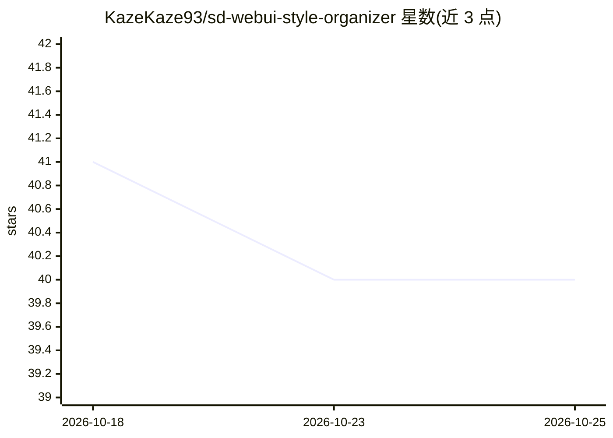

# KazeKaze93/sd-webui-style-organizer

⭐ 40 · JavaScript · AGPL-3.0 · 推送 2026-10-22 · [GitHub](https://github.com/KazeKaze93/sd-webui-style-organizer) · 个人维护

**Stable Diffusion WebUI 的可视化样式选择器扩展**

面向 Forge、reForge 与 AUTOMATIC1111（v1.1.0+）的 WebUI 扩展：用网格/画廊界面替换默认样式下拉框，支持分类浏览、来源过滤、去重的 All Sources 视图与来源选择器、收藏与最近使用、拖拽排序、预设与备份导入导出。提供磁盘扫描的只读 LoRA 卡片侧栏（可选手动获取 CivitAI 标题），并实现 {sg:…}/{sgd:…} 通配符语法在生成时按类别或切片随机选样式。要求宿主以 ES module 方式加载扩展 javascript/*.mjs。

## 筛选速览

| 维度 | 判定 | 备注 |
|---|---|---|
| AI 角色 | `ai-ecosystem` | LLM/agent 周边工具 |
| 许可风险 | `viral` | AGPL-3.0 |
| 部署形态 | `None` |  |
| 模型依赖 | — | README 未给出锁定关系 |
| 硬件要求 | — | 无带数字的原话,不猜 |
| 安装摩擦 | `low` | 无编译、无系统依赖或容器化 |
| 成熟度 | — | 结构信号不足 |

## 能力要点

- 网格化样式浏览：分类过滤、来源过滤、搜索与自动补全
- 收藏/最近/预设与备份导入导出、缩略图生成工具
- 只读 LoRA 卡片侧栏（磁盘扫描，可选 CivitAI 标题补全）
- {sg:}/{sgd:} 通配符在生成时按类别或切片随机展开样式

## 适用场景

- 在 WebUI 中用可视化网格代替样式下拉框挑选和应用样式
- 批量浏览与管理分散在多个 CSV 的样式并去重
- 用通配符在生成时随机抽取某类或选定子集的样式

## 场景标签

`图像生成` · 领域:内容生成

## 证据(README 行号)

> L3: Style Grid replaces the default style dropdown with a fast, visual interface for browsing, selecting, and applying s
> L24: |**AUTOMATIC1111** `stable-diffusion-webui`|**1.1.0** and later (`v1.1.0`)|

## 星数曲线

2026-10-18 41 → 2026-10-25 40（-1）

---
*卡片 v1 · prompt 1.4 · 生成 2026-10-25 · 置信度 high · 依据 README sha `8b1caf8bb35f` · [字段定义](../../DATASET.md)*
