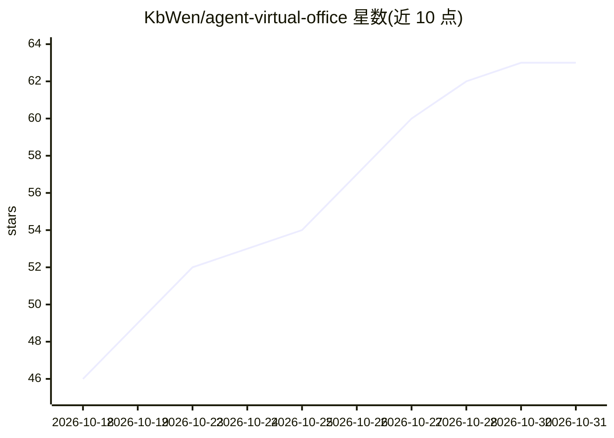

# KbWen/agent-virtual-office

⭐ 63 · JavaScript · MIT · 推送 2026-10-30 · [GitHub](https://github.com/KbWen/agent-virtual-office) · 个人维护 · 中文 README

**在浏览器像素办公室里实时观看 AI 编程 Agent 工作状态**

面向开发者的本地 Web 应用：把 Claude Code、Codex CLI、Gemini CLI、Antigravity 及 CI 的工具调用状态映射为 8 个像素角色的办公场景，显示工作/受阻/空闲状态，支持戳角色、明信片下载等互动。接入方式包括 Claude Code 的 `npx setup` 自动挂接 6 个生命周期钩子、Gemini CLI 项目级 hooks、Antigravity 只读 transcript 观察，以及任意工具的 HTTP POST API。无后端、无数据库、无 WebSocket，可通过 npx 直接运行或 git clone 后 npm 运行；dev 服务器默认暴露到局域网，需 `--no-host` 或带 token 的生产模式收口。

## 筛选速览

| 维度 | 判定 | 备注 |
|---|---|---|
| AI 角色 | `ai-ecosystem` | LLM/agent 周边工具 |
| 许可风险 | `permissive` | MIT |
| 部署形态 | `library` | 以包/库形式分发 |
| 模型依赖 | locked-api |  |
| 硬件要求 | — | 无带数字的原话,不猜 |
| 安装摩擦 | `low` | 无编译、无系统依赖或容器化 |
| 成熟度 | — | 结构信号不足 |

## 能力要点

- 为 Claude Code 一条命令挂接 6 个生命周期/工具钩子上报状态
- Gemini CLI 项目级 hooks 与 Antigravity 只读 transcript 两种适配器
- 任意能发 HTTP 请求的工具均可通过 POST /api/status 上报
- 无后端/数据库/WebSocket，本地浏览器运行；内置繁体中文

## 适用场景

- 写代码时瞟一眼就知道哪个 Agent 在干活、被卡或空闲
- 把面板嵌到 IDE 侧栏观察 Agent 会话
- 团队部署后集中观察 CI 或多名 Agent 的工作状态

## 场景标签

`LLM 可观测性` · 领域:评测与运维

## 证据(README 行号)

> L13: Connect Claude Code, Codex, Gemini CLI, or CI to see who’s working, blocked, or idle in a pixel office. When you ne
> L98: The office reacts to any tool that can send an HTTP request:
> L107: - **Claude Code** → `npx agent-virtual-office setup`, and every tool call routes itself. Done.

## 星数曲线

2026-10-18 46 → 2026-10-31 63（+17）

---
*卡片 v1 · prompt 1.4 · 生成 2026-10-24 · 置信度 high · 依据 README sha `7d343b6d194a` · [字段定义](../../DATASET.md)*
