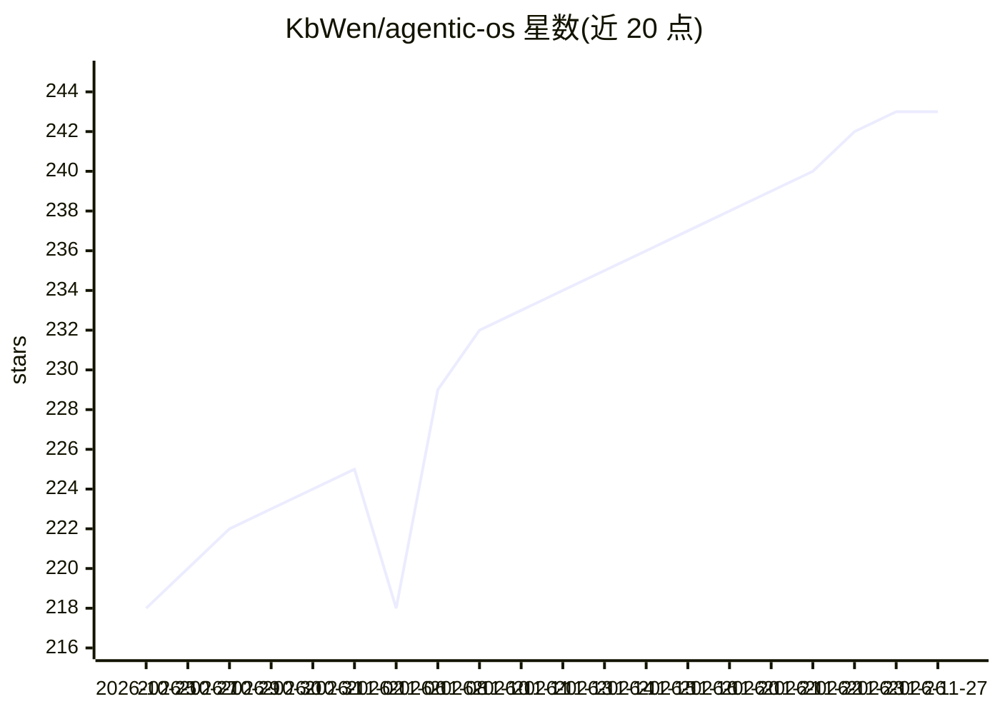

# KbWen/agentic-os

⭐ 243 · Python · MIT · 推送 2026-11-23 · [GitHub](https://github.com/KbWen/agentic-os) · [官网](https://www.kbwen.com/tags/agentic-os/) · 个人维护 · 中文 README

**给 AI 编码代理加门禁与证据校验的治理框架**

面向 AI 编码代理的治理层：通过 plan/build/review/test/ship 五步门禁工作流约束 Claude Code、Codex、Cursor、Copilot、Antigravity 等 Markdown 代理，经 AGENTS.md/CLAUDE.md 等入口文件接入。机制包括独立凭证扫描脚本（可作 pre-commit hook）、读取任务工作日志并校验阶段与证据的本地验证器、按风险分级的多条工作流路径（tiny-fix 到 architecture-change）、跨会话的状态文件与交接记录、14 个按任务类型自动附加的技能清单。安装后默认不启用任何强制项，需按安装器输出手动开启 hook 与 CI。

## 筛选速览

| 维度 | 判定 | 备注 |
|---|---|---|
| AI 角色 | `ai-ecosystem` | LLM/agent 周边工具 |
| 许可风险 | `permissive` | MIT |
| 部署形态 | `None` |  |
| 模型依赖 | — | README 未给出锁定关系 |
| 硬件要求 | — | 无带数字的原话,不猜 |
| 安装摩擦 | `low` | 无编译、无系统依赖或容器化 |
| 成熟度 | — | 结构信号不足 |

## 能力要点

- 凭证扫描、CI 测试与 validate.sh 工作日志校验三层机器强制手段
- 按风险分级的五类任务工作流路径（tiny-fix/quick-win/feature/hotfix/architecture-change）
- 14 个按任务类型自动附加的技能清单（TDD、鉴权安全、迁移检查等）
- 跨会话状态文件与单分支单写者锁，支持多代理协作

## 适用场景

- 防止 AI 编码代理把泄漏密钥提交进 git 历史
- 要求代理在提供 review/test 证据后才允许 ship
- 多个 AI 会话共同修改同一仓库时避免工作日志冲突

## 场景标签

`Agent 框架` `编码 Agent` · 领域:Agent 开发

## 证据(README 行号)

> L6:  A governance-first layer for AI coding agents — guardrails and a gated workflow for Claude Code, Codex, Cursor, Cop
> L64: The second row is the part a rules file can't reach: `validate.sh` parses each task's work log and fails if a requi
> L144: |**Claude Code**|Native|`CLAUDE.md` entrypoint + Claude platform guide|

## 星数曲线

2026-10-25 218 → 2026-11-27 243（+25）

---
*卡片 v1 · prompt 1.4 · 生成 2026-11-25 · 置信度 high · 依据 README sha `15b5c9ff9964` · [字段定义](../../DATASET.md)*
