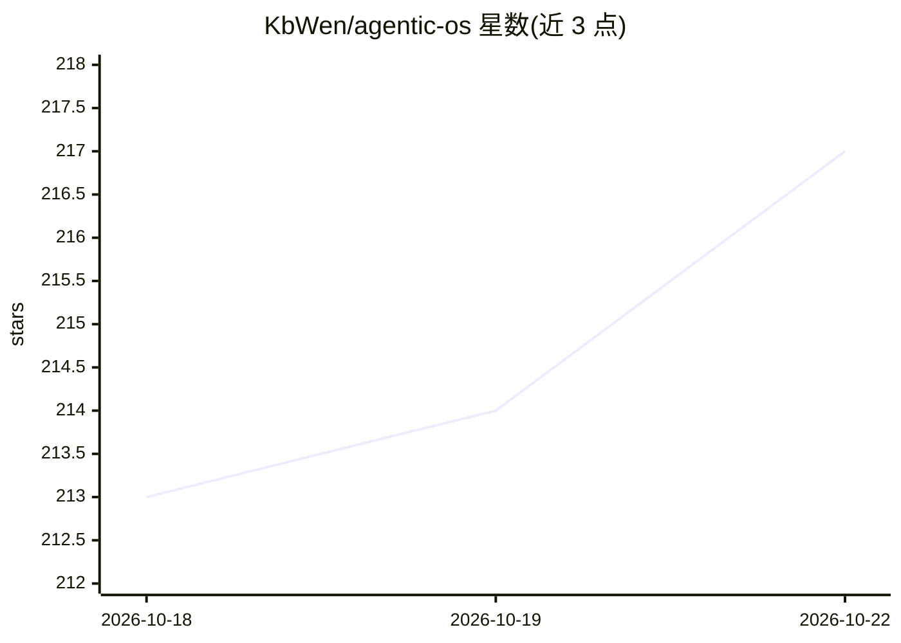

# KbWen/agentic-os

⭐ 217 · Python · MIT · 推送 2026-10-20 · [GitHub](https://github.com/KbWen/agentic-os) · [官网](https://www.kbwen.com/tags/agentic-os/) · 个人维护 · 中文 README

**AI 编码 agent 的治理框架：用 git hook 与 CI 核验证据**

面向 Claude Code、Codex、Cursor、Copilot、Antigravity 等 Markdown 读取的 AI 编码 agent 的治理层：五步门控工作流（plan/build/review/test/ship）要求每个阶段留有证据。核心组件包括 scan_credentials.py 凭据扫描（可设为 pre-commit hook）、validate.sh 读取工作日志校验阶段与证据缺失、record_test_run.py 记录测试运行指纹，以及按任务类型自动附加的 14 个专家清单。新装默认不运行任何强制机制，需手动启用 hook 与 CI 任务；校验器只查记录缺失，不查伪造记录。通过 git clone 加部署脚本安装。

## 筛选速览

| 维度 | 判定 | 备注 |
|---|---|---|
| AI 角色 | `ai-ecosystem` | LLM/agent 周边工具 |
| 许可风险 | `permissive` | MIT |
| 部署形态 | `None` |  |
| 模型依赖 | — | README 未给出锁定关系 |
| 硬件要求 | — | 无带数字的原话,不猜 |
| 安装摩擦 | `low` | 无编译、无系统依赖或容器化 |
| 成熟度 | — | 结构信号不足 |

## 能力要点

- scan_credentials.py 凭据扫描可接入 pre-commit hook 与 CI
- validate.sh 解析任务工作日志，缺失阶段或证据即失败
- 按任务分类（tiny-fix 到 architecture-change）的五档门控流程
- 14 个按任务类型自动附加的专家清单与跨会话工作日志

## 适用场景

- 防止 AI 编码 agent 未测试就声称完成并提交代码
- 拦截泄漏的密钥进入 git 历史
- 多 agent 协作仓库中保持决策与证据的可交接记录

## 场景标签

 · 领域:开发工具/AI 治理

## 证据(README 行号)

> L6:  A governance-first layer for AI coding agents — guardrails and a gated workflow for Claude Code, Codex, Cursor, Cop
> L19:  It checks the evidence behind what your AI coding agent claims — secrets and tests in your git hooks and CI, phase
> L68: Agentic OS is the enforcement layer. A rules file or a skill pack tells your agent how to behave; this is the part 

## 星数曲线

2026-10-18 213 → 2026-10-22 217（+4）

---
*卡片 v1 · prompt 1.4 · 生成 2026-10-22 · 置信度 high · 依据 README sha `6781cba8a8f1` · [字段定义](../../DATASET.md)*
