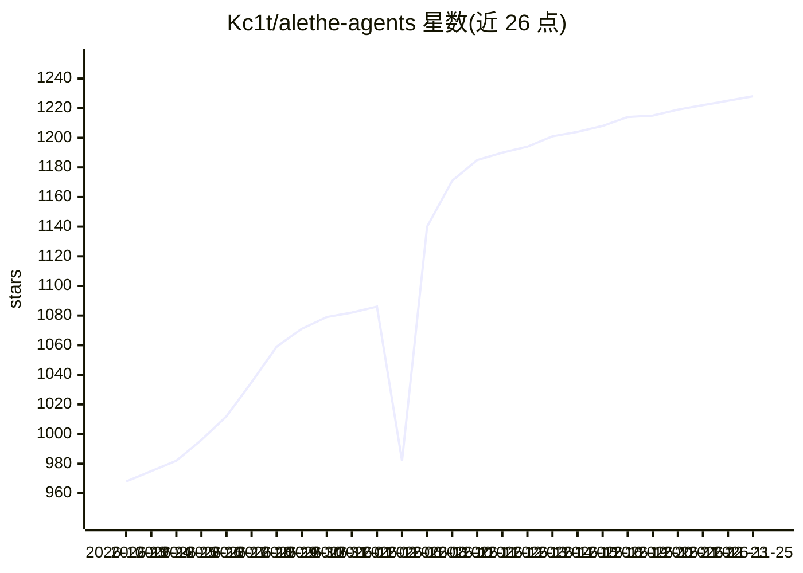

# Kc1t/alethe-agents

⭐ 1,228 · TypeScript · AGPL-3.0 · 推送 2026-11-08 · [GitHub](https://github.com/Kc1t/alethe-agents) · [官网](https://alethe-agents.kc1t.com/) · 个人维护

**本地优先桌面工作区：并行运行与管理多个编程 agent**

基于 Tauri/Rust/React/xterm.js 的跨平台（macOS/Windows/Linux）桌面应用，为 Claude Code、Codex、Copilot 等编程 agent CLI 与 shell 提供真实 PTY、分屏面板与持久布局；每个 agent 保持独立会话与历史，支持崩溃后会话恢复、Claude Code 与 Codex 间的对话交接、MCP 服务器与技能的统一管理、插件系统（含插件目录与 SHA-256 校验）、Git 面板与 PR 审查面板。可选 9router 本地代理做多提供商回退路由，编排板由 lead agent 向并行 worker 分派任务。声明为早期公开版本。

## 筛选速览

| 维度 | 判定 | 备注 |
|---|---|---|
| AI 角色 | `ai-ecosystem` | LLM/agent 周边工具 |
| 许可风险 | `viral` | AGPL-3.0 |
| 部署形态 | `desktop` | 安装包/桌面程序 |
| 模型依赖 | locked-api |  |
| 硬件要求 | — | 无带数字的原话,不猜 |
| 安装摩擦 | `low` | 无编译、无系统依赖或容器化 |
| 成熟度 | `idea` | |

## 能力要点

- 13 类 agent/shell 在真实 PTY 中并行运行，支持会话恢复
- MCP/技能统一管理与跨 agent 配置同步
- 插件系统带权限声明、信任对话框与 SHA-256 校验目录
- alethe 编排技能：lead agent 分派 Claude/Codex worker，输出结果而非转录

## 适用场景

- 同时管理跨多个仓库的多个编程 agent 会话
- 统一查看与修改各 agent 的 MCP 服务器配置
- 用编排板把任务分派给并行 worker 并跟踪成本

## 场景标签

`编码 Agent` `多智能体` · 领域:Agent 开发

## 证据(README 行号)

> L9:  Run Claude Code, Codex, Copilot and your shells side by side — in one local-first desktop app.
> L47: **Alethe is a desktop workspace built for that.** Every agent runs in a real PTY inside a persistent
> L52: Cross-platform (Windows, macOS, Linux), local-first, built with Tauri, Rust, React, and `xterm.js`.

## 星数曲线

2026-10-23 968 → 2026-11-25 1,228（+260）

---
*卡片 v1 · prompt 1.4 · 生成 2026-11-23 · 置信度 mid · 依据 README sha `142b84851415` · [字段定义](../../DATASET.md)*
