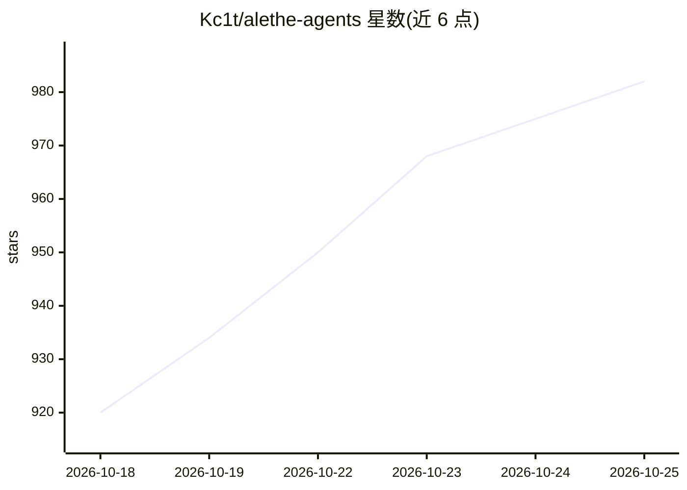

# Kc1t/alethe-agents

⭐ 996 · TypeScript · AGPL-3.0 · 推送 2026-10-24 · [GitHub](https://github.com/Kc1t/alethe-agents) · [官网](https://alethe-agents.kc1t.com/) · 个人维护 · 中文 README

**本地优先桌面工作台：并行运行、组织与恢复多个编码 agent 与终端**

基于 Tauri/Rust/React/xterm.js 的跨平台桌面应用，为同时运行多个编码 agent（Claude Code、Codex、Copilot CLI、Cursor 等 13 种 CLI 与 shell）提供工作区：每个 agent 在真实 PTY 中运行并持有独立会话与历史，支持会话崩溃后恢复、Claude Code 会话向 Codex 的本地脱敏交接、MCP 服务器与技能的集中管理、插件系统、编排看板（lead agent 分派 worker）以及可选的 9router 本地代理与局域网手机远程控制。面向同时操作多个 agent 与仓库的开发者。限制：更新检查与提供商用量轮询默认开启（local-first 而非 local-only）；Windows 构建未代码签名，macOS 未公证；Remote Control 使用未加密 HTTP/WebSocket。

## 筛选速览

| 维度 | 判定 | 备注 |
|---|---|---|
| AI 角色 | `ai-ecosystem` | LLM/agent 周边工具 |
| 许可风险 | `viral` | AGPL-3.0 |
| 部署形态 | `desktop` | 安装包/桌面程序 |
| 模型依赖 | — | README 未给出锁定关系 |
| 硬件要求 | — | 无带数字的原话,不猜 |
| 安装摩擦 | `low` | 无编译、无系统依赖或容器化 |
| 成熟度 | `idea` | |

## 能力要点

- 13 种 agent CLI 与 shell 在独立 PTY 中并行运行，会话可崩溃后恢复
- MCP 服务器集中管理：读取各家配置、跨 agent 复制、原子写入
- Claude Code 会话可经本地脱敏的上下文包交接给 Codex
- 插件系统带权限声明、SHA-256 校验与信任对话框；编排看板支持 lead-worker 并行委派

## 适用场景

- 同时跑多个编码 agent 处理多个仓库，避免终端标签页混乱
- 统一管理各 agent 的 MCP 服务器与技能配置
- 在手机上通过局域网远程查看并回复 agent 的提问
- 把一个 Claude Code 对话交接给 Codex 继续处理

## 场景标签

`多智能体` · 领域:Agent 开发

## 证据(README 行号)

> L47: **Alethe is a desktop workspace built for that.** Every agent runs in a real PTY inside a persistent
> L49: of that, Alethe manages the things agents share: their CLIs, their MCP servers, their skills, and the
> L97: Agents can optionally be routed through 9router, a local proxy

## 星数曲线

2026-10-18 920 → 2026-10-25 982（+62）

---
*卡片 v1 · prompt 1.4 · 生成 2026-10-21 · 置信度 high · 依据 README sha `2cec7b0d3d3c` · [字段定义](../../DATASET.md)*
