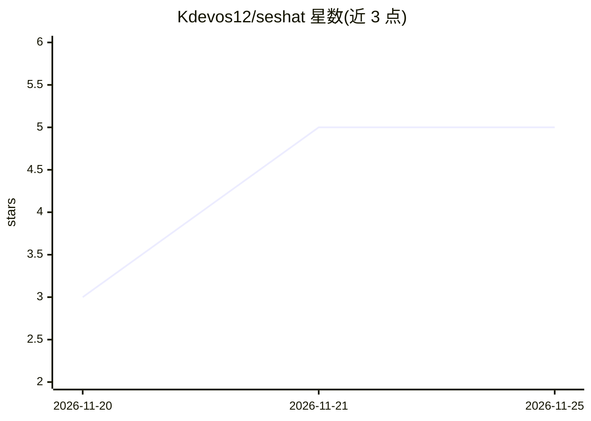

# Kdevos12/seshat

⭐ 5 · TypeScript · Apache-2.0 · 推送 2026-11-20 · [GitHub](https://github.com/Kdevos12/seshat) · 个人维护

**自主数学研究的 LLM agent 框架：Lean4 核验每条证明**

面向数学研究者与形式化爱好者的开源 agent harness：输入 Lean 或自然语言陈述并设预算上限，先运行经典工具（决策程序、 tactic 电池、SMT、CAS），再让 LLM 在短会话中写 Lean 证明；仅当 Lean 内核在沙箱重放通过才标记 proved。全程写入哈希链日志，每步付费前先计价并有硬性美元上限。Node/TypeScript monorepo，支持 Linux/macOS（Windows 经 WSL2），首次完整安装约需一小时与 15 GB 磁盘。

## 筛选速览

| 维度 | 判定 | 备注 |
|---|---|---|
| AI 角色 | `ai-native` | 本体是模型或模型工具 |
| 许可风险 | `permissive` | Apache-2.0 |
| 部署形态 | `None` |  |
| 模型依赖 | — | README 未给出锁定关系 |
| 硬件要求 | — | 无带数字的原话,不猜 |
| 安装摩擦 | `low` | 无编译、无系统依赖或容器化 |
| 成熟度 | `idea` | |

## 能力要点

- 以 Lean 内核重放为唯一 proved 判定来源
- 经典工具优先，模型仅在必要时且先计价再调用
- 哈希链日志可复现，支持中断续跑
- 预算门槛与硬性美元上限控制成本

## 适用场景

- 自动证明或反驳竞赛级数学命题
- 在预算内长时间自主探索猜想
- 消融比较不同研究机制的有效性

## 场景标签

`Agent 框架` `科研工具` · 领域:Agent 开发

## 证据(README 行号)

> L14: A harness for autonomous mathematical research with language models: **models through their APIs, Lean as the judge
> L16: Give Seshat a mathematical statement, in Lean or in plain English, and a dollar cap. It tries fifty years of classi
> L27: - **Trust comes from Lean, not from a model.** A claim is `proved` or `refuted` only after the certifier compiles t

## 星数曲线

2026-11-20 3 → 2026-11-25 5（+2）

---
*卡片 v1 · prompt 1.4 · 生成 2026-11-21 · 置信度 high · 依据 README sha `8be5d4b8f5d7` · [字段定义](../../DATASET.md)*
