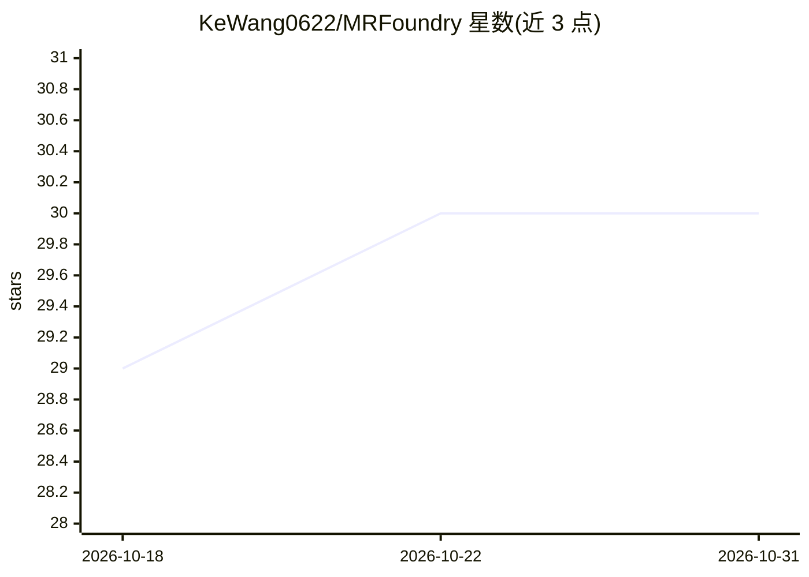

# KeWang0622/MRFoundry

⭐ 30 · Python · MIT · 推送 2026-10-29 · [GitHub](https://github.com/KeWang0622/MRFoundry) · [官网](https://kewang0622.github.io/slides/mrfoundry/) · 个人维护

**给编码 agent 的 MRI 科研技能与参考知识库（7 个技能）**

面向编码 agent 的 MRI 研究指导资源库：提供 7 个可安装技能（Markdown 指令与辅助工具），覆盖 MRI 物理、序列设计、重建、深度学习重建、扩散 MRI、硬件与科研工作流，指导 agent 选择与使用 PyPulseq、KomaMRI、BART、SigPy、MRtrix3、DIPY 等既有科学工具；附带按主题组织的论文/教科书注释书目与项目本地研究记忆笔记本（.mrfoundry/）。技能安装不包含科学应用本体，科学工具需单独安装；结果依赖具体 agent 与工具访问，README 明示其为示例而非保证。

## 筛选速览

| 维度 | 判定 | 备注 |
|---|---|---|
| AI 角色 | `ai-knowledge` | 知识聚合/清单类 |
| 许可风险 | `permissive` | MIT |
| 部署形态 | `library` | 以包/库形式分发 |
| 模型依赖 | — | README 未给出锁定关系 |
| 硬件要求 | — | 无带数字的原话,不猜 |
| 安装摩擦 | `low` | 无编译、无系统依赖或容器化 |
| 成熟度 | — | 结构信号不足 |

## 能力要点

- 7 个可安装技能覆盖序列设计、重建、扩散 MRI 等 MRI 科研环节
- 指导 agent 在隔离环境中安装并测试 PyPulseq/KomaMRI/BART 等既有工具
- 带完整引文与来源链接的注释参考书目（含论文、课程、数据集）
- 项目本地研究记忆笔记本（INDEX/runs/lessons 结构）

## 适用场景

- 让编码 agent 按领域知识设计并模拟 MRI 序列、重建数据
- 为 MRI 重建研究规划基线、指标与文献综述
- 在项目内沉淀实验记录与可复用研究经验
- 按 MRM/MICCAI 等期刊要求规划论文写作与证据映射

## 场景标签

`科研工具` `知识库管理` `教程课程` · 领域:知识与检索

## 证据(README 行号)

> L11: Coding agents can write MRI code, but choosing the right signal model, data convention, tool and validation takes d
> L40: Choose one, several or all seven skills. Browse the skills directory. These are Markdown instructions and supportin
> L132: **Papers and textbooks by skill →** — all seven skills have an

## 星数曲线

2026-10-18 29 → 2026-10-31 30（+1）

---
*卡片 v1 · prompt 1.4 · 生成 2026-10-26 · 置信度 high · 依据 README sha `9849841e2117` · [字段定义](../../DATASET.md)*
