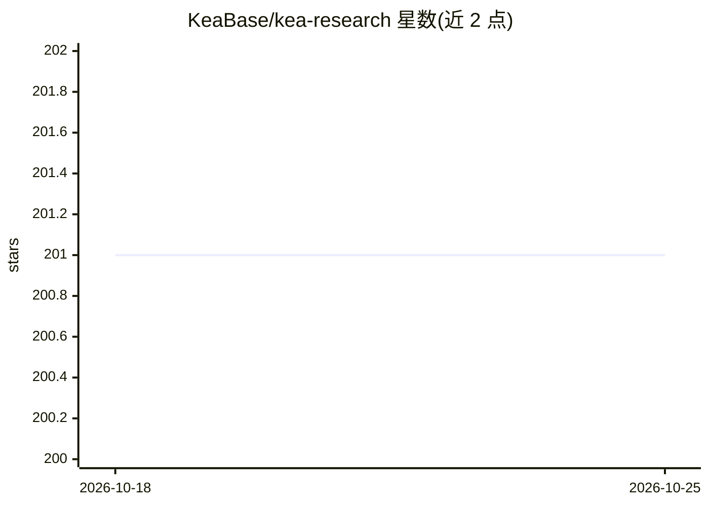

# KeaBase/kea-research

⭐ 201 · TypeScript · NOASSERTION · 推送 2026-01-25 · [GitHub](https://github.com/KeaBase/kea-research) · [官网](https://research.keabase.com) · 组织维护

**多 AI 协作研究平台：多模型交叉验证产出共识答案**

面向终端用户的多 AI 协作平台：将同一个问题交给多个模型（默认 5 个），经 4 步流水线处理——独立作答、参考匿名同伴回答后改进、互相评级、由排名最高的模型合成最终答案；同时从各回答中抽取原子事实做交叉验证，标记并排除有争议或无支持的声明。支持 OpenAI、Anthropic、Google、Mistral、xAI、OpenRouter 及 Ollama/LM Studio 等 OpenAI 兼容接入，提供研究分层子对话、图片输入、多格式导出、Web 管理面板与 75 种语言界面。安装依赖 Docker，通过 curl/PowerShell 脚本或 git clone 后 docker compose 部署。

## 筛选速览

| 维度 | 判定 | 备注 |
|---|---|---|
| AI 角色 | `ai-native` | 本体是模型或模型工具 |
| 许可风险 | `none` | NOASSERTION |
| 部署形态 | `self-host` | docker 或自建部署 |
| 模型依赖 | local-ok | 支持本地模型 |
| 硬件要求 | — | 无带数字的原话,不猜 |
| 安装摩擦 | `low` | 无编译、无系统依赖或容器化 |
| 成熟度 | — | 结构信号不足 |

## 能力要点

- 4 步共识流水线：独立作答→改进→互评→合成最终答案
- 原子事实抽取与交叉验证，争议声明被标记并排除
- 接入 OpenAI/Anthropic/Google/Mistral/xAI/OpenRouter/Ollama 等多提供商
- 研究分层子对话、多格式导出（Markdown/HTML/JSON/纯文本）、Web 管理面板

## 适用场景

- 对复杂问题获取多个 AI 模型交叉验证后的共识答案
- 文献综述与事实核查需要多视角对比的任务
- 了解不同 AI 模型在哪些观点上一致或分歧

## 场景标签

`多智能体` `科研工具` · 领域:Agent 开发

## 证据(README 行号)

> L5:  Multi-AI collaboration platform that combines responses from multiple AI models,
> L56: |Step|Process|Purpose|
> L58: |**1. Initial**|Each AI answers independently|Gather diverse perspectives without bias|

## 星数曲线

2026-10-18 201 → 2026-10-25 201（+0）

---
*卡片 v1 · prompt 1.4 · 生成 2026-10-22 · 置信度 high · 依据 README sha `c4e4fec9fd6f` · [字段定义](../../DATASET.md)*
