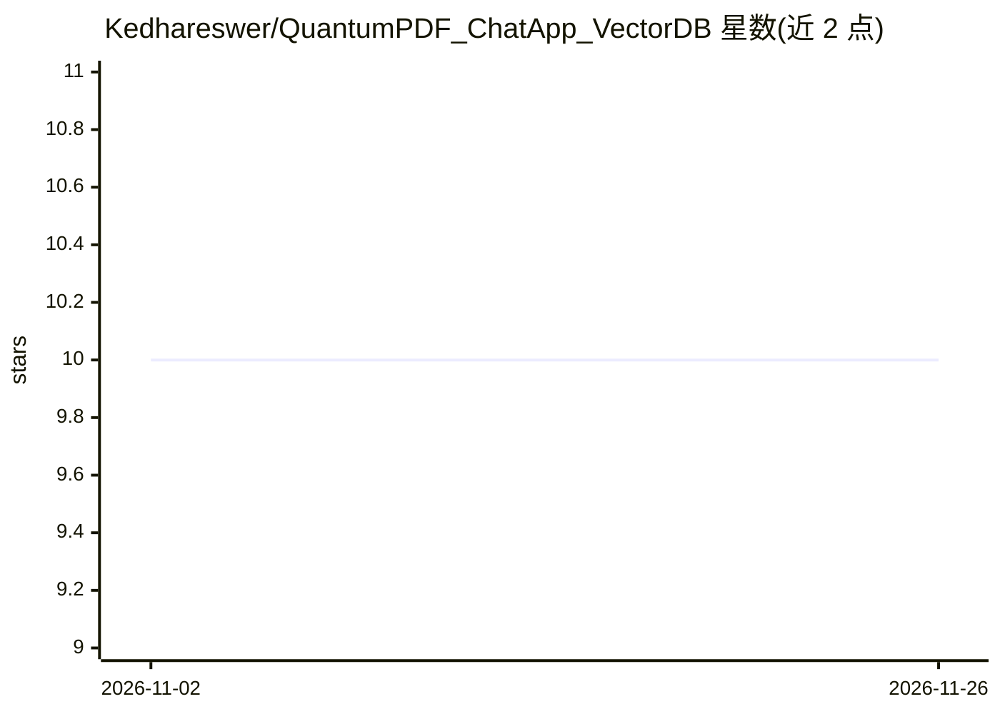

# Kedhareswer/QuantumPDF_ChatApp_VectorDB

⭐ 10 · TypeScript · GPL-3.0 · 推送 2026-10-09 · [GitHub](https://github.com/Kedhareswer/QuantumPDF_ChatApp_VectorDB) · [官网](https://v0-rag-pdf-chatbot-eight.vercel.app) · 个人维护

**面向 PDF 用户的 RAG 问答应用：多提供方接入+护栏+评估**

基于 Next.js 与 React 的文档问答平台：上传 PDF/Word/PPT/Excel 等格式后，通过三阶段 RAG（上下文分析→自我批评→精炼回答）生成带内联引用的回答；配套护栏系统（输入校验、限速、毒性/PII 检测）、评估指标（检索质量、groundedness、引用覆盖、延迟）、跨文档公平检索与混合检索。支持 14 个 AI 提供方，矢量库可选内存/Pinecone/Weaviate；PDF 服务端解析含 OCR，非 PDF 在浏览器内转 Markdown。需自备至少一个提供方的 API key，本地推理路径不存在。

## 筛选速览

| 维度 | 判定 | 备注 |
|---|---|---|
| AI 角色 | `ai-native` | 本体是模型或模型工具 |
| 许可风险 | `viral` | GPL-3.0 |
| 部署形态 | `library` | 以包/库形式分发 |
| 模型依赖 | locked-api |  |
| 硬件要求 | — | 无带数字的原话,不猜 |
| 安装摩擦 | `low` | 无编译、无系统依赖或容器化 |
| 成熟度 | — | 结构信号不足 |

## 能力要点

- 三阶段 RAG：Context Analysis → Self-Critique → Refined Answer
- 接入 14 个 AI 提供方（OpenAI、Anthropic、Google、Groq、DeepSeek 等）
- 护栏系统：输入校验、限速、毒性检测、PII 检测
- 矢量库可选内存/Pinecone/Weaviate，PDF 服务端解析含 OCR

## 适用场景

- 与自己的 PDF 文档对话并获得带引用来源的回答
- 多文档库中按文档筛选提问并查看检索 chunk
- 构建带护栏与评估指标的文档问答应用

## 场景标签

`文档问答` `RAG` · 领域:知识与检索

## 证据(README 行号)

> L3: > **Advanced document analysis with 3-phase RAG, guardrails, evaluation metrics, and 14 AI providers**
> L17: |**3-Phase RAG**|Context Analysis → Self-Critique → Refined Answer|
> L18: |**14 AI Providers**|OpenAI, Anthropic, Google, Groq, DeepSeek, Mistral, xAI, and more|

## 星数曲线

2026-11-02 10 → 2026-11-26 10（+0）

---
*卡片 v1 · prompt 1.4 · 生成 2026-11-20 · 置信度 mid · 依据 README sha `ed6f997e6241` · [字段定义](../../DATASET.md)*
