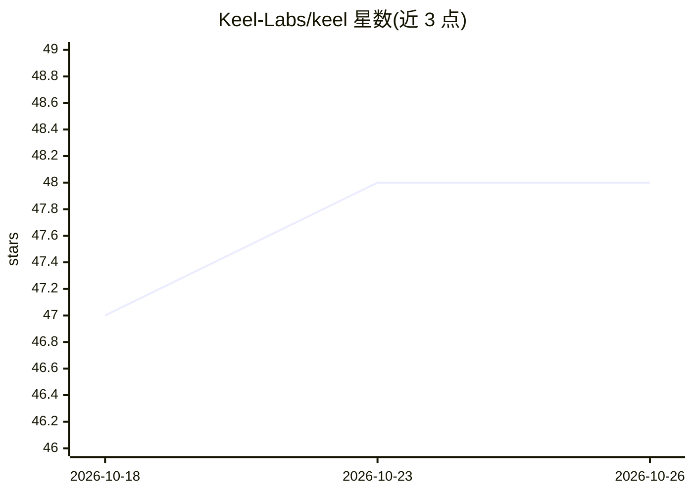

# Keel-Labs/keel

⭐ 48 · TypeScript · MIT · 推送 2026-07-22 · [GitHub](https://github.com/Keel-Labs/keel) · [官网](https://github.com/Keel-Labs/keel/releases/latest) · 个人维护

**本地优先的 Mac/Windows AI 助手，记忆存为 markdown 归用户所有**

Electron 桌面应用（macOS/Windows）：以磁盘上的纯 markdown 文件夹（默认 ~/Keel）作为工作区，承载项目、每日日志、任务与 wiki 知识库。支持接入 Claude、OpenAI、OpenRouter 或本地 Ollama 模型，可随时切换且上下文保留在本地。功能含上下文感知聊天、自动捕获、任务提醒、本地 Whisper 会议转录、定时任务与 Google Workspace/X 集成。无需账号、无遥测，MIT 许可。当前为 v1 beta（Windows 较新），无多机同步与团队功能，由单人维护。

## 筛选速览

| 维度 | 判定 | 备注 |
|---|---|---|
| AI 角色 | `ai-native` | 本体是模型或模型工具 |
| 许可风险 | `permissive` | MIT |
| 部署形态 | `desktop` | 安装包/桌面程序 |
| 模型依赖 | local-ok | 支持本地模型 |
| 硬件要求 | — | 无带数字的原话,不猜 |
| 安装摩擦 | `low` | 无编译、无系统依赖或容器化 |
| 成熟度 | `idea` | |

## 能力要点

- 工作区为本地纯 markdown 文件，可自备份与版本控制
- 自带模型：Claude/OpenAI/OpenRouter/本地 Ollama 可随时切换
- 本地 Whisper 会议转录与语音输入，生成结构化摘要
- 项目级知识库（/create-kb），摄取 markdown 与 PDF 并随文件变更同步

## 适用场景

- 把 AI 助手的记忆和笔记掌握在自己磁盘上，避免厂商锁定
- 在多个模型供应商（含本地模型）间切换而保留上下文
- 用 AI 管理任务、每日简报与项目知识库

## 场景标签

`AI 助手` `知识库管理` `文档问答` · 领域:对话与助手

## 证据(README 行号)

> L5: Keel is a local-first desktop app for macOS and Windows that captures what matters from your conversations into plai
> L49: **Bring your own model.** Keel speaks to Claude, OpenAI, OpenRouter, and local models via Ollama. Swap providers in
> L53: **Context-aware chat.** Every conversation draws on a system prompt assembled from your workspace: relevant project

## 星数曲线

2026-10-18 47 → 2026-10-26 48（+1）

---
*卡片 v1 · prompt 1.4 · 生成 2026-10-25 · 置信度 mid · 依据 README sha `60163c4342ee` · [字段定义](../../DATASET.md)*
