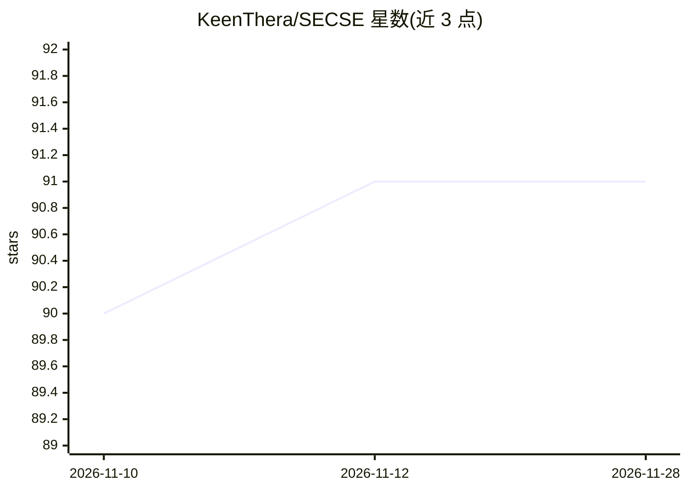

# KeenThera/SECSE

⭐ 91 · Python · Apache-2.0 · 推送 2026-11-10 · [GitHub](https://github.com/KeenThera/SECSE) · 组织维护

**药物发现用化学空间探索器：从种子片段进化生长分子**

SECSE 是面向药物发现的从头分子设计工具：在蛋白质口袋内从种子片段出发，按生长规则逐代生成小分子，经分子性质过滤与对接打分（锦标赛排名）选择下一代种子，迭代探索化学空间。对接后端支持 Vina、Uni-Dock、AutoDock GPU 与 Glide（Glide 需 Schrödinger 许可）；可选安装 Chemprop 训练打分预测模型以减少对接量。通过 setup.sh/Conda 安装，需 Linux、GNU Parallel 与 Perl，提供 CLI 与 INI 配置。

## 筛选速览

| 维度 | 判定 | 备注 |
|---|---|---|
| AI 角色 | `ai-native` | 本体是模型或模型工具 |
| 许可风险 | `permissive` | Apache-2.0 |
| 部署形态 | `library` | 以包/库形式分发 |
| 模型依赖 | — | README 未给出锁定关系 |
| 硬件要求 | `cpu-ok` | |
| 安装摩擦 | `medium` | 含编译或系统依赖之一 |
| 成熟度 | — | 结构信号不足 |

## 能力要点

- 片段生长+逐代对接选择的进化式化学空间探索
- 四种对接后端：Vina/Uni-Dock/AutoDock GPU/Glide
- 可选 Chemprop 打分预测（每代或末尾训练）
- 丰富的分子性质过滤（MW/logP/QED/Lipinski/PAINS 等）

## 适用场景

- 从已知活性片段出发在靶点口袋中生长新分子
- 批量生成并筛选满足成药性约束的候选分子
- 用预测模型减少分子对接的计算量

## 场景标签

 · 领域:药物发现/计算化学

## 证据(README 行号)

> L5: SECSE grows small molecules from seed fragments in a protein pocket. In each generation, it applies growth rules,
> L6: filters the new molecules and uses docking scores to select seeds for the next round. You can use Chemprop to
> L7: predict scores and decide which additional candidates to dock.

## 星数曲线

2026-11-10 90 → 2026-11-28 91（+1）

---
*卡片 v1 · prompt 1.4 · 生成 2026-11-17 · 置信度 mid · 依据 README sha `3e04d52f4fb5` · [字段定义](../../DATASET.md)*
