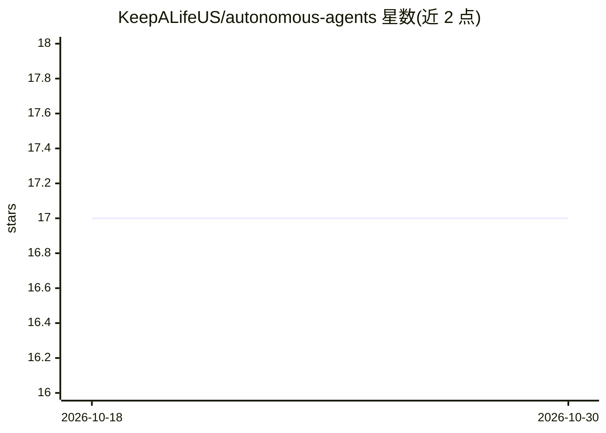

# KeepALifeUS/autonomous-agents

⭐ 17 · MIT · 推送 2026-03-13 · [GitHub](https://github.com/KeepALifeUS/autonomous-agents) · 个人维护

**通过蚁群式共识协调 4 个 AI agent 的软件开发多智能体系统**

由 4 个专业化 Claude API agent（THINKER 架构、BUILDER-UI 前端、BUILDER-DDD 后端、GUARDIAN 审查）组成的软件开发多智能体系统。协调机制为共识（stigmergy）：agent 间不直接通信，全部通过共享 Git 仓库中的 JSON 文件交换任务、审查与知识，用 Git 冲突检测充当分布式锁。含自愈机制（超时释放、自动变基）与每 24 小时的自我改进循环。README 称通过增量上下文加载实现 80% token 减少。以 git clone 源码方式提供，目标项目为 TypeScript/React/Node.js/PostgreSQL。

## 筛选速览

| 维度 | 判定 | 备注 |
|---|---|---|
| AI 角色 | `ai-ecosystem` | LLM/agent 周边工具 |
| 许可风险 | `permissive` | MIT |
| 部署形态 | `None` |  |
| 模型依赖 | locked-api |  |
| 硬件要求 | — | 无带数字的原话,不猜 |
| 安装摩擦 | `low` | 无编译、无系统依赖或容器化 |
| 成熟度 | — | 结构信号不足 |

## 能力要点

- 4 个专职 agent 通过 Git 仓库中的共享文件协调，无中央编排器与消息传递
- 以 Git 冲突检测作为分布式互斥锁处理任务认领
- 自愈机制：4 小时崩溃超时释放、锁过期、冲突自动变基
- 每 24 小时基于拒绝模式运行自我改进循环

## 适用场景

- 部署 GUARDIAN agent 持续自动审查 PR 与安全问题
- 多个 agent 并行规划与撰写文档或内容
- 多 agent 分布式探索研究问题并在共享知识库积累结果
- 按配置文件扩展自 4 个至 N 个 agent 的自组织开发团队

## 场景标签

`多智能体` `编码 Agent` `代码审查` · 领域:Agent 开发

## 证据(README 行号)

> L7: > **4 AI agents collaborate on software development without direct communication, coordinating like ant colonies thr
> L182: - **Agent Runtime:** Claude API (Anthropic)

## 星数曲线

2026-10-18 17 → 2026-10-30 17（+0）

---
*卡片 v1 · prompt 1.4 · 生成 2026-10-30 · 置信度 high · 依据 README sha `fff5d7c9a50e` · [字段定义](../../DATASET.md)*
