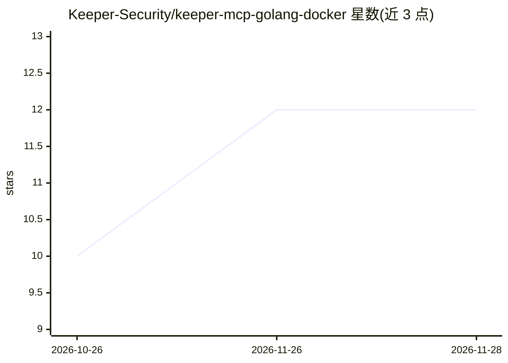

# Keeper-Security/keeper-mcp-golang-docker

⭐ 12 · Go · MIT · 推送 2026-07-16 · [GitHub](https://github.com/Keeper-Security/keeper-mcp-golang-docker) · [官网](https://www.keepersecurity.com/secrets-manager.html) · 组织维护

**让 AI 通过 MCP 安全管理 Keeper 密钥的服务器**

Keeper Secrets Manager 的 MCP 服务器实现，在 AI 语言模型（如 Claude）与 KSM 之间充当中介：AI agent 可通过工具列出、检索、创建、更新、删除密钥记录与文件夹、上传下载附件、生成密码、读取 TOTP 码。敏感操作默认需用户确认，敏感字段默认遮蔽；提供 Docker 与预编译二进制两种部署方式，支持本地加密 profile 存储、批量模式、静默模式（禁用审计日志）等配置。需要有效的 KSM 应用 base64 配置方可运行。

## 筛选速览

| 维度 | 判定 | 备注 |
|---|---|---|
| AI 角色 | `ai-ecosystem` | LLM/agent 周边工具 |
| 许可风险 | `permissive` | MIT |
| 部署形态 | `desktop` | 安装包/桌面程序 |
| 模型依赖 | — | README 未给出锁定关系 |
| 硬件要求 | — | 无带数字的原话,不猜 |
| 安装摩擦 | `low` | 无编译、无系统依赖或容器化 |
| 成熟度 | — | 结构信号不足 |

## 能力要点

- 13+ 个 MCP 工具覆盖密钥、文件夹、附件的增删改查
- 敏感操作需用户确认，支持 --auto-approve 与 ksm_execute_confirmed_action 选择性审批
- Docker 与预编译二进制两种部署方式，多路配置优先级（CLI/环境变量/profile）
- --no-logs 静默模式与密码保护的本地 profile 加密存储

## 适用场景

- 通过 Claude Desktop 用自然语言管理团队密钥记录
- 在 CI/CD 或容器等自动化环境中以批量模式运行密钥操作
- 让 AI 帮忙生成强密码并直接存入密钥库而不暴露明文
- 让 AI 分析跨环境（dev/qa）密钥配置的一致性

## 场景标签

`工作流自动化` `网络安全` `AI 助手` · 领域:效率与自动化

## 证据(README 行号)

> L3: KSM MCP is a Model Context Protocol (MCP) server that acts as a secure intermediary between AI language models (like
> L62: The KSM MCP server provides the following tools to interact with Keeper Secrets Manager:

## 星数曲线

2026-10-26 10 → 2026-11-28 12（+2）

---
*卡片 v1 · prompt 1.4 · 生成 2026-11-20 · 置信度 high · 依据 README sha `ba2273dd76bc` · [字段定义](../../DATASET.md)*
