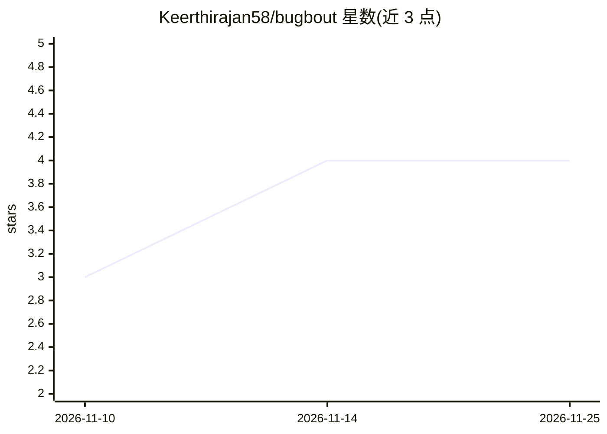

# Keerthirajan58/bugbout

⭐ 4 · Python · MIT · 推送 2026-11-10 · [GitHub](https://github.com/Keerthirajan58/bugbout) · [官网](https://pypi.org/project/bugbout/) · 个人维护

**在你的代码库上评测编码 agent 修 bug 能力的 CLI**

bugbout 从项目自身 git 历史中挖掘带测试的真实修复，将其转化为修 bug 任务；多个编码 agent 在无历史、无隐藏测试的沙箱 checkout 中竞争生成补丁，由维护者随修复提交的隐藏测试判定补丁是否真正修复。工作流程分五步：挖掘任务、确定 ground truth、agent 竞速、互相交叉检验测试、按证据评分。内置支持 Codex、Claude Code、Gemini CLI、mini-swe-agent，其他命令行 agent 可少量配置接入，也可比较包括本地模型在内的模型。需要 macOS/Linux、Python 3.12+、git、uv。

## 筛选速览

| 维度 | 判定 | 备注 |
|---|---|---|
| AI 角色 | `ai-ecosystem` | LLM/agent 周边工具 |
| 许可风险 | `permissive` | MIT |
| 部署形态 | `library` | 以包/库形式分发 |
| 模型依赖 | — | README 未给出锁定关系 |
| 硬件要求 | — | 无带数字的原话,不猜 |
| 安装摩擦 | `low` | 无编译、无系统依赖或容器化 |
| 成熟度 | — | 结构信号不足 |

## 能力要点

- 从项目 git 历史自动挖掘带测试的真实修复作为评测任务
- 隐藏测试（维护者测试）评分，agent 无法接触 ground truth
- 内置 Codex/Claude Code/Gemini CLI/mini-swe-agent，自定义 agent 几行配置接入
- agent 在 OS 沙箱、无 git 历史、断网环境内运行

## 适用场景

- 在引入新编码 agent 前，先在自己的代码库上量化其修 bug 表现
- 比较不同模型（含本地模型）在自家代码规范与测试套件下的表现
- 检验 agent 互相交叉审查能否在被采纳前拦截不合格补丁

## 场景标签

`模型评测` · 领域:评测与运维

## 证据(README 行号)

> L11: **Which coding agent actually fixes bugs in *your* codebase?**
> L25: - **Bring any agent.** Codex, Claude Code, Gemini CLI and mini-swe-agent work out of
> L36: You need macOS or Linux (on Windows, use WSL2), Python 3.12+, git,

## 星数曲线

2026-11-10 3 → 2026-11-25 4（+1）

---
*卡片 v1 · prompt 1.4 · 生成 2026-11-21 · 置信度 high · 依据 README sha `0f0947232a43` · [字段定义](../../DATASET.md)*
