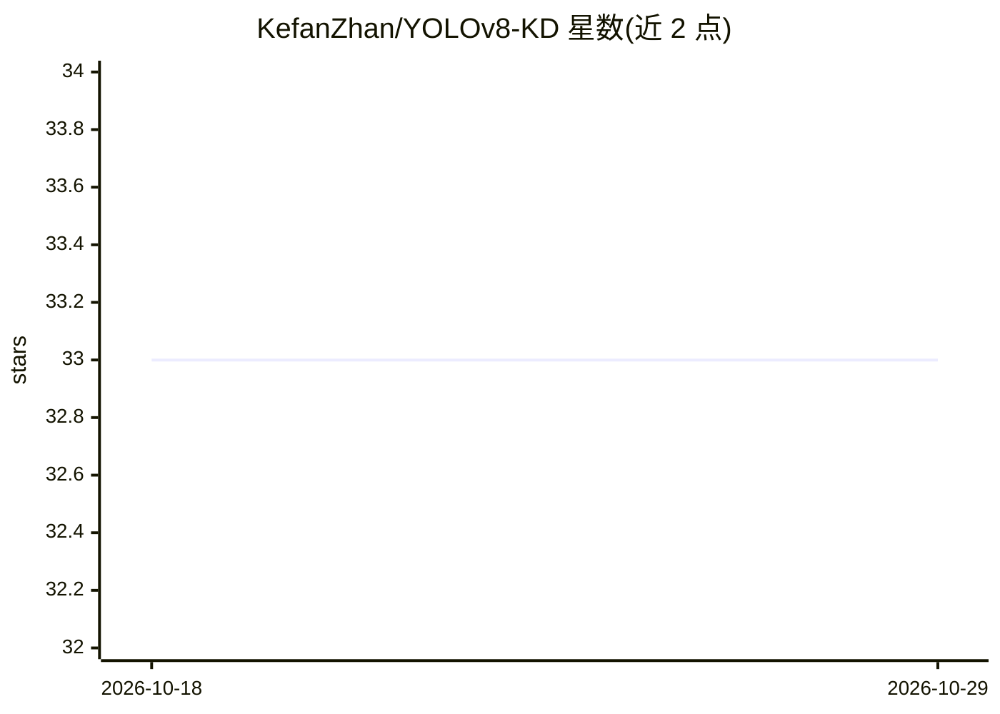

# KefanZhan/YOLOv8-KD

⭐ 33 · Python · 推送 2026-05-14 · [GitHub](https://github.com/KefanZhan/YOLOv8-KD) · 个人维护

**在 YOLOv8 上实现多种知识蒸馏与混合量化方法的训练代码库**

基于 YOLOv8（PyTorch）构建的科研代码库，实现 6 种发表于 AAAI/CVPR/TGRS/BMVC 等会议期刊的知识蒸馏方法（AFD、ReviewKD、FGD、OST、CrossKD、CSAKD），用于目标检测模型压缩；另提供可与蒸馏组合的混合量化实现，支持设定量化位宽。训练与测试通过 main.py 进行，蒸馏相关参数以预定义额外参数形式提供。作者为学生开发者，首个学术项目，2025 年 6 月开源。

## 筛选速览

| 维度 | 判定 | 备注 |
|---|---|---|
| AI 角色 | `ai-native` | 本体是模型或模型工具 |
| 许可风险 | `none` | — |
| 部署形态 | `None` |  |
| 模型依赖 | — | README 未给出锁定关系 |
| 硬件要求 | — | 无带数字的原话,不猜 |
| 安装摩擦 | `low` | 无编译、无系统依赖或容器化 |
| 成熟度 | — | 结构信号不足 |

## 能力要点

- 实现 AFD、ReviewKD、FGD、OST、CrossKD、CSAKD 共 6 种蒸馏方法
- 提供可与蒸馏组合的混合量化，支持设定量化位宽
- 构建于 YOLOv8（PyTorch），训练测试入口为 main.py

## 适用场景

- 目标检测模型做知识蒸馏压缩实验
- 对比不同蒸馏方法在 YOLOv8 上的效果
- 蒸馏与混合量化组合进行模型压缩

## 场景标签

`模型量化` · 领域:训练与推理

## 证据(README 行号)

> L5: - Attention-based Feature-level Distillation (AFD, AAAI-2021)
> L34: This code is built on YOLOv8 (PyTorch). We thank the authors for sharing the codes.

## 星数曲线

2026-10-18 33 → 2026-10-29 33（+0）

---
*卡片 v1 · prompt 1.4 · 生成 2026-10-25 · 置信度 high · 依据 README sha `7d823d300b35` · [字段定义](../../DATASET.md)*
