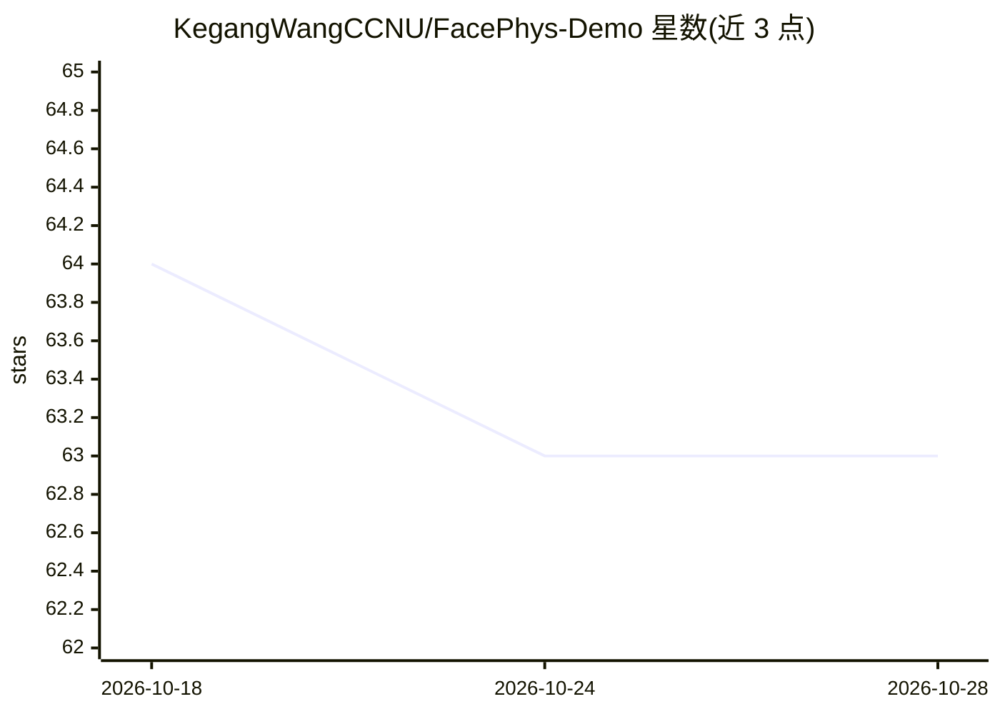

# KegangWangCCNU/FacePhys-Demo

⭐ 63 · JavaScript · NOASSERTION · 推送 2026-08-03 · [GitHub](https://github.com/KegangWangCCNU/FacePhys-Demo) · [官网](https://kegangwangccnu.github.io/FacePhys-Demo/) · 个人维护

**网页端 rPPG 生理监测演示：摄像头面部视频测心率**

基于浏览器的远程光电容积描记（rPPG）监测演示应用，通过标准摄像头采集面部视频，使用状态空间模型（SSM）提取心率与心率变异性。推理在本地以 LiteRT 与 WebAssembly 完成，模型约 4MB，延迟约 5ms。视频与生理信号不上传服务器，加载后可离线运行。以 PWA 形式提供，可在桌面与移动端安装为独立应用，界面采用 Windows 95/98 风格。

## 筛选速览

| 维度 | 判定 | 备注 |
|---|---|---|
| AI 角色 | `ai-native` | 本体是模型或模型工具 |
| 许可风险 | `none` | NOASSERTION |
| 部署形态 | `None` |  |
| 模型依赖 | — | README 未给出锁定关系 |
| 硬件要求 | — | 无带数字的原话,不猜 |
| 安装摩擦 | `low` | 无编译、无系统依赖或容器化 |
| 成熟度 | — | 结构信号不足 |

## 能力要点

- 状态空间模型处理面部视频提取心率与心率变异性
- LiteRT + WebAssembly 本地推理，模型约 4MB、延迟约 5ms
- 零数据上传，加载后可离线运行
- Web Workers 多线程推理与实时注意力热图/3D 状态轨迹可视化

## 适用场景

- 在浏览器中用摄像头非接触式测量心率
- 查看 rPPG 模型的实时可视化演示
- 离线环境下体验端侧生理信号推理

## 场景标签

`图像视频处理` · 领域:感知与多模态

## 证据(README 行号)

> L11: FacePhys Demo is a browser-based remote photoplethysmography (rPPG) monitor. It uses State Space Models (SSMs) to e
> L13: The application runs inference locally using LiteRT and WebAssembly. It is designed for edge environments, offering

## 星数曲线

2026-10-18 64 → 2026-10-28 63（-1）

---
*卡片 v1 · prompt 1.4 · 生成 2026-10-24 · 置信度 high · 依据 README sha `f4742c7ac54d` · [字段定义](../../DATASET.md)*
