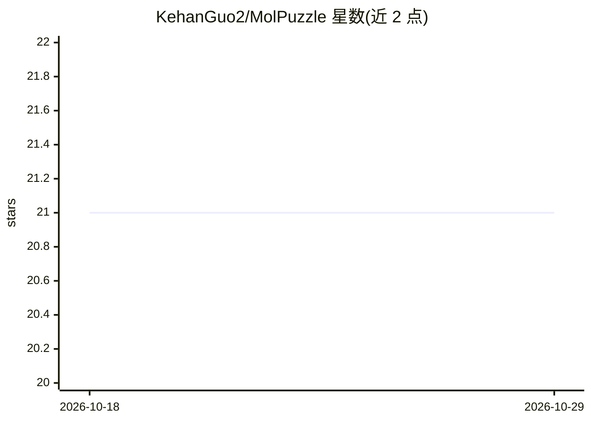

# KehanGuo2/MolPuzzle

⭐ 21 · Python · MIT · 推送 2026-01-02 · [GitHub](https://github.com/KehanGuo2/MolPuzzle) · 组织维护

**基于 LLM 的分子结构解析多模态基准（NeurIPS 24）**

从 IR、质谱、H-NMR、C-NMR 四类光谱数据推断分子结构的评测框架：将光谱数据自动转换为自然语言问答对，分三个阶段（基础性质、官能团识别、完整结构解析）组织数据集，支持采样生成测试集、调用模型生成回答并评测。基准对象包括 GPT-4、Claude 及开源 VLM 模型。以 Python 包与脚本形式提供，本地推理需 PyTorch，CUDA 为可选。

## 筛选速览

| 维度 | 判定 | 备注 |
|---|---|---|
| AI 角色 | `ai-knowledge` | 知识聚合/清单类 |
| 许可风险 | `permissive` | MIT |
| 部署形态 | `library` | 以包/库形式分发 |
| 模型依赖 | — | README 未给出锁定关系 |
| 硬件要求 | — | 无带数字的原话,不猜 |
| 安装摩擦 | `low` | 无编译、无系统依赖或容器化 |
| 成熟度 | — | 结构信号不足 |

## 能力要点

- 覆盖 IR/质谱/H-NMR/C-NMR 四类光谱的多模态分析
- 光谱数据自动转换为自然语言 QA 对
- 三阶段数据集：基础性质→官能团识别→完整结构解析
- 支持 GPT-4、Claude 与开源 VLM 的基准评测

## 适用场景

- 评测 LLM 在分子结构解析任务上的表现
- 将光谱数据转为问答数据集用于研究
- 扩展添加新模型或数据集进行对比实验

## 场景标签

`模型评测` `多模态` · 领域:评测与运维

## 证据(README 行号)

> L7: MolPuzzle is a comprehensive framework for elucidating molecular structures from spectral data (IR, Mass Spectrometr
> L13: - **Model Evaluation**: Benchmarks LLM performance on chemical structure elucidation tasks.

## 星数曲线

2026-10-18 21 → 2026-10-29 21（+0）

---
*卡片 v1 · prompt 1.4 · 生成 2026-10-28 · 置信度 high · 依据 README sha `9413f111fa9e` · [字段定义](../../DATASET.md)*
