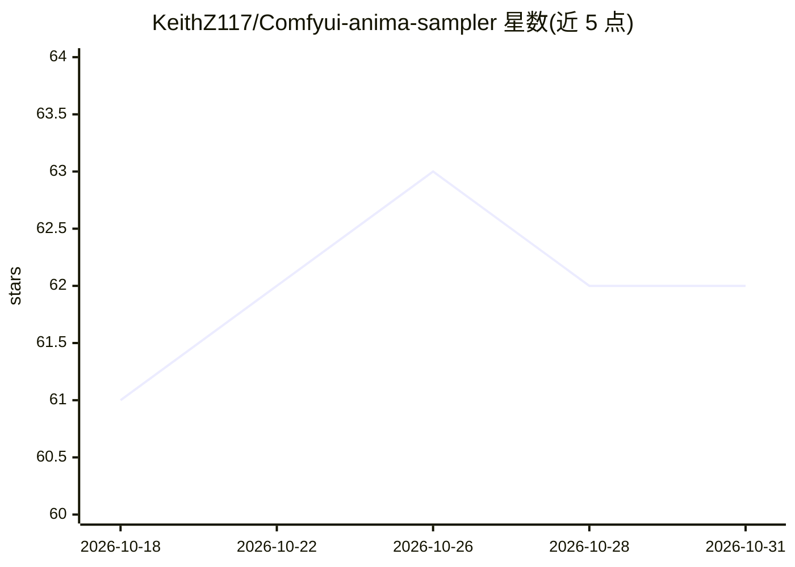

# KeithZ117/Comfyui-anima-sampler

⭐ 62 · Python · MIT · 推送 2026-06-10 · [GitHub](https://github.com/KeithZ117/Comfyui-anima-sampler) · 个人维护

**面向 Anima 模型的 ComfyUI 自定义采样器节点集**

为 Anima / Cosmos 风格的 rectified-flow 图像模型提供 ComfyUI 自定义采样器节点：默认打包 Anima Diffusers FlowMatch Euler 调度（flow_euler + flow_diffusers_linear_shift + shift 3.0），并提供 UniPC、PC3、AB2 等可选求解器与多种 sigma 网格调度（RF linear shift、rho7/Karras、S-tail 等）供 A/B 测试。节点面精简为采样器主节点与可选设置节点，支持 LATENT/IMAGE 双输出与可选 VAE 直连解码。非 NVIDIA 或 CircleStone Labs 官方发布，仓库不含模型权重，需按官方模型卡自行安装。MIT 许可。

## 筛选速览

| 维度 | 判定 | 备注 |
|---|---|---|
| AI 角色 | `ai-ecosystem` | LLM/agent 周边工具 |
| 许可风险 | `permissive` | MIT |
| 部署形态 | `None` |  |
| 模型依赖 | — | README 未给出锁定关系 |
| 硬件要求 | — | 无带数字的原话,不猜 |
| 安装摩擦 | `low` | 无编译、无系统依赖或容器化 |
| 成熟度 | — | 结构信号不足 |

## 能力要点

- 默认遵循 Anima Diffusers 官方调度配置（flow_euler + linear shift 3.0 + const CFG 5.0）
- 提供 FlowUniPC、PC3、AB2 等多种求解器变体及 Cosmos 2.5 风格 RF linear shift 调度
- 节点面精简为采样器与设置两个节点，支持 ramp CFG 与可选 final clean pass
- 附带示例工作流 JSON 与本地单元测试

## 适用场景

- 在 ComfyUI 中为 Anima 模型替换默认采样器节点
- 对比不同求解器与调度组合的出图效果
- 按官方 Diffusers 配置复现 Anima 推理路径

## 场景标签

`图像生成` · 领域:内容生成

## 证据(README 行号)

> L3: Custom ComfyUI sampler nodes for Anima / Cosmos-style rectified-flow image
> L60: - `Anima Flow Corrective Sampler`: the main sampler node.

## 星数曲线

2026-10-18 61 → 2026-10-31 62（+1）

---
*卡片 v1 · prompt 1.4 · 生成 2026-10-24 · 置信度 high · 依据 README sha `34dd6fad63da` · [字段定义](../../DATASET.md)*
