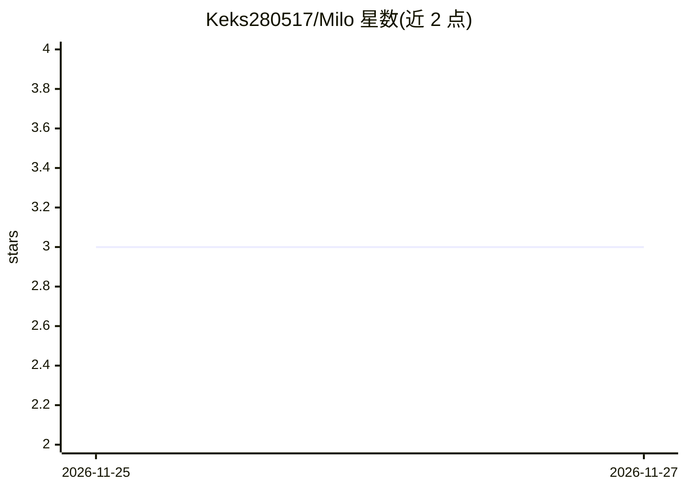

# Keks280517/Milo

⭐ 3 · Rust · MIT · 推送 2026-11-15 · [GitHub](https://github.com/Keks280517/Milo) · 个人维护

**Windows 桌面 AI 助手：屏幕顶部胶囊形态，本地语音与快命令**

运行于 Windows 顶部胶囊（灵动岛式）UI 的个人 AI 助手：点击展开聊天、语音、天气、文件、笔记、系统状态、计时器等面板。请求在本地按 0-100 分数路由：快命令不经过 AI，轻问题走 Gemini Flash-Lite/Groq 或本地模型，难问题走 Gemini Flash；支持纯本地模式（Ollama/LM Studio，自动检测服务器并一键下载推荐模型）。语音识别（Parakeet/Whisper）与唤醒词全部本地运行，音频不存储不上传。提供安装包与源码构建，另有浏览器扩展增强页面操作，并作为 Claude Code 的伴侣界面展示其编辑文件、命令与权限请求。

## 筛选速览

| 维度 | 判定 | 备注 |
|---|---|---|
| AI 角色 | `ai-native` | 本体是模型或模型工具 |
| 许可风险 | `permissive` | MIT |
| 部署形态 | `desktop` | 安装包/桌面程序 |
| 模型依赖 | local-ok | 支持本地模型 |
| 硬件要求 | — | 无带数字的原话,不猜 |
| 安装摩擦 | `low` | 无编译、无系统依赖或容器化 |
| 成熟度 | `idea` | |

## 能力要点

- 本地请求评分路由：快命令离线执行、AI 调用按难度分级
- 本地 AI 一键配置：检测 Ollama/LM Studio 并推荐下载适配模型
- 完全本地语音：Parakeet/Whisper 识别与 Hey Milo 唤醒词
- Claude Code 伴侣视图：diff、任务列表、权限审批与用量限额

## 适用场景

- 在桌面常驻一个可对话、可控应用和文件的 AI 助手
- 不想数据出本机时用 Ollama/LM Studio 纯本地运行
- 免手操作：唤醒词语音输入与全局文本改写（翻译/摘要等）
- 从胶囊界面监控并响应 Claude Code 的工作状态

## 场景标签

`AI 助手` `语音 Agent` · 领域:对话与助手

## 证据(README 行号)

> L5: **A personal AI desktop assistant for Windows that lives in a small pill at the top of your screen, in the style of 
> L16: - **AI chat with tools.** Gemini (with an optional, very fast Groq model as a partner and fallback) can open and ar
> L17: - **Local AI, if you prefer.** Don't want to use Google? Milo works with Ollama or LM Studio and detects a running 

## 星数曲线

2026-11-25 3 → 2026-11-27 3（+0）

---
*卡片 v1 · prompt 1.4 · 生成 2026-11-25 · 置信度 high · 依据 README sha `ec2c6fdb91a4` · [字段定义](../../DATASET.md)*
