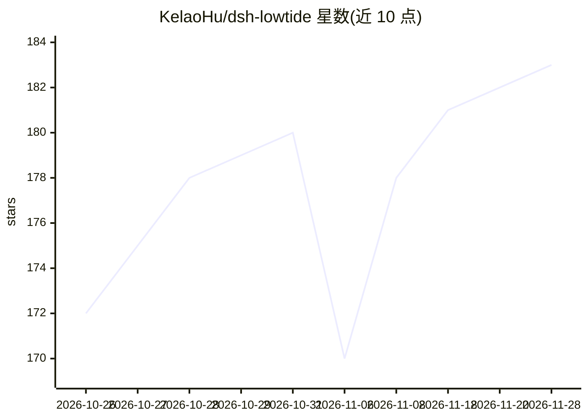

# KelaoHu/dsh-lowtide

⭐ 183 · TypeScript · MIT · 推送 2026-11-16 · [GitHub](https://github.com/KelaoHu/dsh-lowtide) · 个人维护 · 中文 README

**给 DeepSeek Harness 用户的错峰任务队列插件：闲时排任务，谷时自动跑**

lowtide 是 DeepSeek Harness (dsh) 的插件，解决白天随手记下的 agent 任务等待与高峰计费问题：任务入队后经人工放行（L1/L2/L3 三档自主级别），在设定的低谷价格时间窗自动执行，次日产出报告供审阅。提供 single/iterative/sampling/review 四种执行策略、按 workspace 划分的沙箱与文件锁、五道 preflight 检查与每日预算限制，宿主侧为 Node.js Cordis 服务，浏览器侧为 React，同一构建产物覆盖桌面与 web。安装需先具备 dsh 与可用的模型接入。

## 筛选速览

| 维度 | 判定 | 备注 |
|---|---|---|
| AI 角色 | `ai-ecosystem` | LLM/agent 周边工具 |
| 许可风险 | `permissive` | MIT |
| 部署形态 | `library` | 以包/库形式分发 |
| 模型依赖 | locked-api |  |
| 硬件要求 | — | 无带数字的原话,不猜 |
| 安装摩擦 | `low` | 无编译、无系统依赖或容器化 |
| 成熟度 | — | 结构信号不足 |

## 能力要点

- 四种执行策略：single、iterative、sampling（2-5 候选并列）、review（独立会话批判性审查）
- 三档自主级别：逐任务确认 / 批量放行 / 全自动，所有任务默认需人工放行
- 五道 preflight 检查（workspace 存在、git HEAD、文件 sha256 锁、时间窗、预算）与沙箱执行
- 同一构建产物同时服务 dsh 桌面端与 web 端，并提供 API 提交任务

## 适用场景

- 下班前排好明天的重构、周报等任务，早上看报告验收
- 周末全天低谷价批量跑依赖清理、补测试等杂务
- 在常驻服务器上以全自动模式按计划执行提交的任务
- 高峰时段想到新任务时一键改为谷时执行并保留草稿

## 场景标签

`工作流自动化` `编码 Agent` · 领域:效率与自动化

## 证据(README 行号)

> L17: lowtide is a plugin for DeepSeek Harness (dsh). The problem it solves is plain and perfectly natural:
> L118: **The Cordis microkernel.** dsh runs on the Cordis microkernel plugin ecosystem: every capability is a plugin, and
> L130: **One-line install (prebuilt):** `dsh plugin --profile web add https://github.com/KelaoHu/dsh-lowtide/releases/lat

## 星数曲线

2026-10-26 172 → 2026-11-28 183（+11）

---
*卡片 v1 · prompt 1.4 · 生成 2026-11-26 · 置信度 high · 依据 README sha `f2ad06d7bfe9` · [字段定义](../../DATASET.md)*
