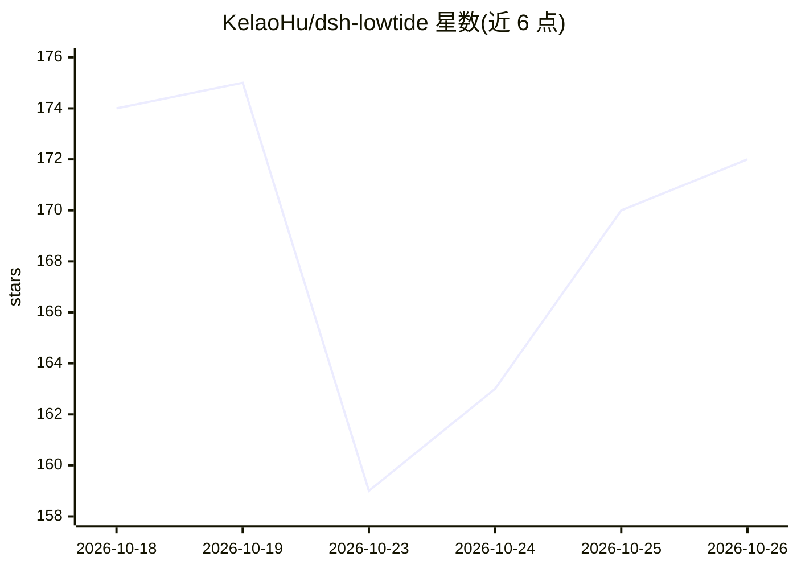

# KelaoHu/dsh-lowtide

⭐ 172 · TypeScript · MIT · 推送 2026-10-17 · [GitHub](https://github.com/KelaoHu/dsh-lowtide) · 个人维护 · 中文 README

**DeepSeek Harness 的错峰任务排队插件：闲时提交、谷价自动执行**

dsh-lowtide 是 DeepSeek Harness (dsh) 的 Cordis 插件，面向希望在模型谷价时段自动执行批量 agent 任务的用户。机制：任务先入队并经人工审核放行（L1–L3 三档自治级别），到设定的低谷窗口后由调度器在沙箱内自动运行，五道预检门（workspace 存在、git HEAD、锁定文件 sha256、窗口、预算）不过则置为 stale 或延期；次日晨报汇总结果与节省费用。提供 single/iterative/sampling/review 四种执行策略，桌面与 web 共用一个构建产物。需先安装 dsh（Node ^22.19||>=24、pnpm 11.7）。

## 筛选速览

| 维度 | 判定 | 备注 |
|---|---|---|
| AI 角色 | `ai-ecosystem` | LLM/agent 周边工具 |
| 许可风险 | `permissive` | MIT |
| 部署形态 | `library` | 以包/库形式分发 |
| 模型依赖 | locked-api |  |
| 硬件要求 | — | 无带数字的原话,不猜 |
| 安装摩擦 | `low` | 无编译、无系统依赖或容器化 |
| 成熟度 | — | 结构信号不足 |

## 能力要点

- 四执行策略：single / iterative / sampling / review
- L1–L3 三档自治级别，任务须经人工放行才执行
- 五道预检门（workspace/git HEAD/锁定文件 sha256/窗口/预算）
- 一次构建同时服务桌面与 web，同源行为

## 适用场景

- 白天攒任务、低谷价时段自动批量执行，早晨看报告
- 采样策略并行产出多个候选方案供人工挑选
- 常驻服务器上通过 API 投递任务全自动错峰运行

## 场景标签

`工作流自动化` · 领域:效率与自动化

## 证据(README 行号)

> L17: lowtide is a plugin for DeepSeek Harness (dsh). The problem it solves is plain and perfectly natural:

## 星数曲线

2026-10-18 174 → 2026-10-26 172（-2）

---
*卡片 v1 · prompt 1.4 · 生成 2026-10-22 · 置信度 mid · 依据 README sha `9b134ada20f9` · [字段定义](../../DATASET.md)*
