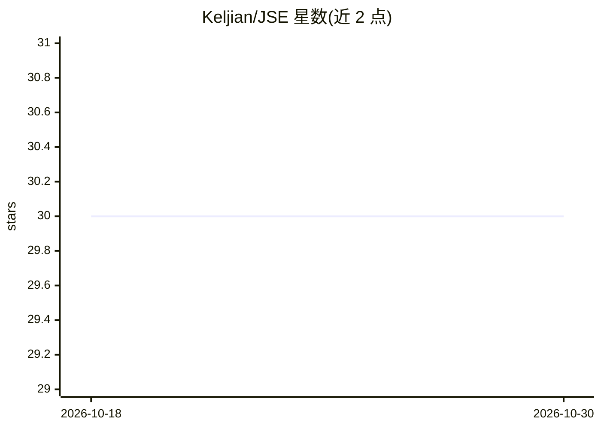

# Keljian/JSE

⭐ 30 · Python · NOASSERTION · 推送 2026-10-18 · [GitHub](https://github.com/Keljian/JSE) · [官网](https://ko-fi.com/keljian) · 个人维护

**本地优先的求职全流程桌面助手：抓取、匹配、生成材料、看板跟踪**

在本地运行的桌面求职助手：通过插件抓取多个招聘网站的职位，用本地 LLM（LM Studio/Ollama）或多车道并行进行分层匹配评分，把求职者的历史申请与文档碎片化索引为候选人知识库，据此生成个人风格的自荐材料；同时提供看板式申请管线、雇主调研、漏斗转化统计与市场分析。数据全部存本地，云端 AI 凭据为可选。打包版目前为未签名 beta，需另装本地 AI 运行时与 Chrome。

## 筛选速览

| 维度 | 判定 | 备注 |
|---|---|---|
| AI 角色 | `ai-native` | 本体是模型或模型工具 |
| 许可风险 | `none` | NOASSERTION |
| 部署形态 | `desktop` | 安装包/桌面程序 |
| 模型依赖 | local-ok | 支持本地模型 |
| 硬件要求 | — | 无带数字的原话,不猜 |
| 安装摩擦 | `low` | 无编译、无系统依赖或容器化 |
| 成熟度 | `idea` | |

## 能力要点

- 插件驱动的职位抓取与自修复爬虫机制
- 候选人知识库（Fragment/RAG）基于历史申请持续积累个人语料
- 分层匹配：先廉价初筛后深度评估，可并行 2-8 个分析
- 看板式申请管线、面试追踪与转化率学习

## 适用场景

- 管理多个求职方向，自动抓取并按匹配度评分职位
- 基于自己的历史文档生成个人风格的求职材料
- 在本地 LLM 上完成职位匹配，数据不出本机
- 用看板跟踪申请进度、面试反馈与跟进计划

## 场景标签

`网页抓取` `RAG` `AI 写作` · 领域:效率与自动化

## 证据(README 行号)

> L3: A local-first desktop assistant for the whole job hunt: find listings, score them against one or more career lanes, 
> L36: - **Choose who does the matching.** Triage and scoring default to your local model, but the **Job matching** workfl
> L49: - **Documents in your own voice.** Application material is generated through the cloud LLM of your choice (e.g. Gem

## 星数曲线

2026-10-18 30 → 2026-10-30 30（+0）

---
*卡片 v1 · prompt 1.4 · 生成 2026-10-26 · 置信度 mid · 依据 README sha `c197e5d080bd` · [字段定义](../../DATASET.md)*
