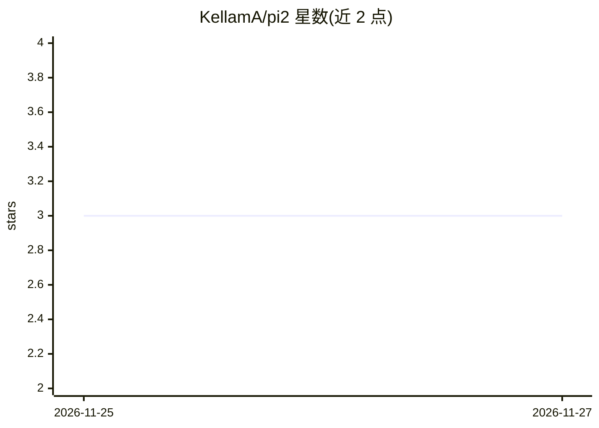

# KellamA/pi2

⭐ 3 · Swift · 推送 2026-11-26 · [GitHub](https://github.com/KellamA/pi2) · 组织维护

**Mac 上的 AI agent 宿主应用：项目化调度多 agent 且工作不因崩溃丢失**

pi² 是运行在 Mac 上的原生 AI agent 应用，基于 pi durable 库：每个模型回合、工具调用与决策在展示前先持久化，崩溃、重启或退出后可从断点继续。以文件夹创建项目，orchestrator 与用户共同规划并把任务分派给各带独立模型、工具与权限的 agent；提供审批队列（Needs you）、Dashboard 多项目视图、定时调度、computer use、内置浏览器、用量统计与每日预算等机制。需 macOS 15 及 Apple silicon，磁盘镜像安装。

## 筛选速览

| 维度 | 判定 | 备注 |
|---|---|---|
| AI 角色 | `ai-ecosystem` | LLM/agent 周边工具 |
| 许可风险 | `none` | — |
| 部署形态 | `None` |  |
| 模型依赖 | local-ok | 支持本地模型 |
| 硬件要求 | — | 无带数字的原话,不猜 |
| 安装摩擦 | `low` | 无编译、无系统依赖或容器化 |
| 成熟度 | `idea` | |

## 能力要点

- 每步模型回合与工具调用先落盘，崩溃/重启后从断点恢复
- orchestrator 规划并分派子 agent，各 agent 可用不同模型与权限
- 四级工具访问控制（Off/Read files/Ask first/Full access）与逐项审批
- 支持约 40 个 provider 的 API key、订阅登录、自定义端点及本机运行模型

## 适用场景

- 让多个 agent 在后台并行处理仓库的 issue 与 PR，回来后统一审批
- 长时间任务在应用重启后不丢失进度
- 让 agent 在受控权限下操作本机应用与浏览器
- 按模型/项目统计 token 与费用并设每日预算

## 场景标签

`多智能体` `GUI 自动化` · 领域:Agent 开发

## 证据(README 行号)

> L20: pi² is a home for AI agents on your Mac, built on pi durable. Every model turn, tool call and decision is saved bef
> L22: It works with the models you already have: sign in with a subscription, paste an API key, point it at a local serve

## 星数曲线

2026-11-25 3 → 2026-11-27 3（+0）

---
*卡片 v1 · prompt 1.4 · 生成 2026-11-24 · 置信度 mid · 依据 README sha `d9184d4d956b` · [字段定义](../../DATASET.md)*
