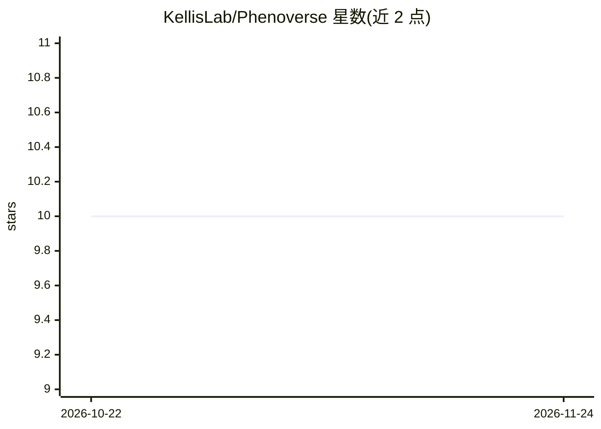

# KellisLab/Phenoverse

⭐ 10 · Python · MIT · 推送 2026-07-23 · [GitHub](https://github.com/KellisLab/Phenoverse) · [官网](https://kellislab.github.io/Phenoverse/) · 组织维护

**单细胞转录组样本表征的可解释深度学习工具**

Phenoverse 是一个以 PyPI 包发布的 Python 工具，用于对单细胞转录组数据进行深度可解释学习，生成样本级表征以刻画疾病状态。README 本身内容极简，仅说明可通过 GitHub issue 反馈 bug、使用方式见文档站，并给出论文引用信息与框架示意图。核心算法细节、安装命令、依赖与使用示例均需查阅其外部文档获取。

## 筛选速览

| 维度 | 判定 | 备注 |
|---|---|---|
| AI 角色 | `ai-native` | 本体是模型或模型工具 |
| 许可风险 | `permissive` | MIT |
| 部署形态 | `library` | 以包/库形式分发 |
| 模型依赖 | — | README 未给出锁定关系 |
| 硬件要求 | — | 无带数字的原话,不猜 |
| 安装摩擦 | `low` | 无编译、无系统依赖或容器化 |
| 成熟度 | — | 结构信号不足 |

## 能力要点

- 以 PyPI 包形式发布的 Python 工具
- 基于深度可解释学习的样本级表征生成
- 提供文档站与框架示意图

## 适用场景

- 对单细胞转录组样本做疾病状态表征
- 在精准医学研究中分析患者表型与组学数据

## 场景标签

`科研工具` · 领域:学习与行业

## 证据(README 行号)

> L1: ## Deep interpretable learning of sample representations for characterizing disease states in single-cell transcript
> L19: Wagle, M.M., Wang, Y., Samanta, S., Liu, Z., Patrick, E., Yang, P & Kellis, M. Deep interpretable learning of sampl

## 星数曲线

2026-10-22 10 → 2026-11-24 10（+0）

---
*卡片 v1 · prompt 1.4 · 生成 2026-11-20 · 置信度 mid · 依据 README sha `22bd32ff9678` · [字段定义](../../DATASET.md)*
