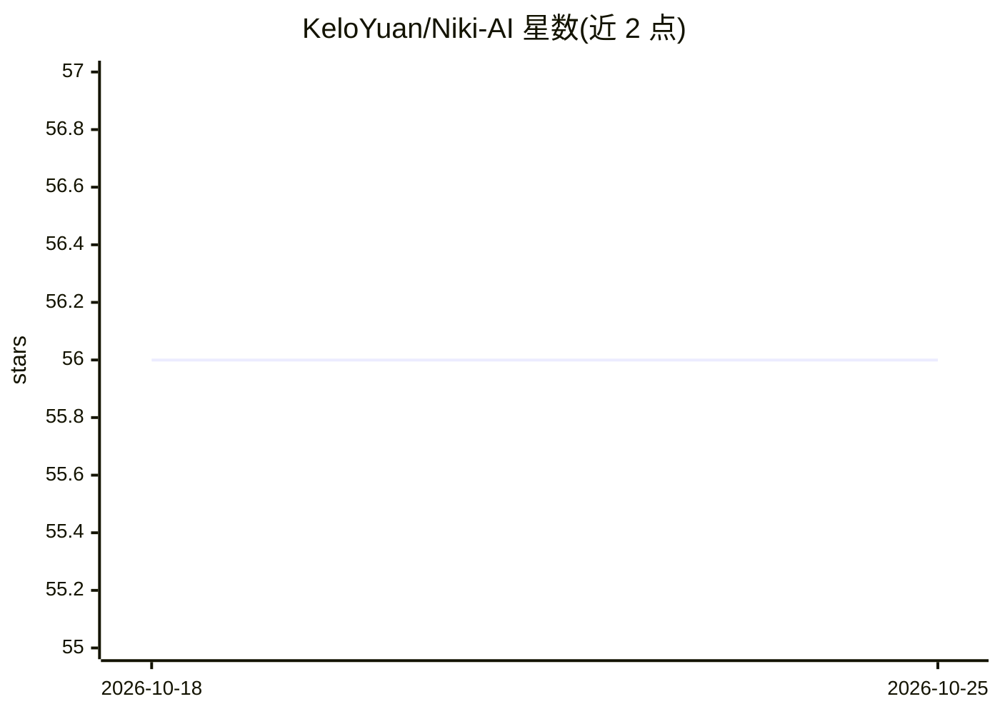

# KeloYuan/Niki-AI

⭐ 56 · JavaScript · MIT · 推送 2026-05-22 · [GitHub](https://github.com/KeloYuan/Niki-AI) · 个人维护 · 中文 README

**把 Claude Code 嵌入 Obsidian 侧边栏的 AI 写作插件**

TypeScript 编写的 Obsidian 插件，将 Claude Code CLI 嵌入侧边栏聊天界面：支持 Opus/Sonnet/Haiku 模型切换、完整 MCP 工具链、@ 引用与拖拽文件/文件夹作为上下文、AI 修改文件的撤销系统、Diff 预览审查后应用、多话题与多助手预设。数据本地处理，支持自定义 API 端点与第三方代理。前置依赖为 Claude Code CLI（npm 或官方脚本安装），插件本体通过 Release 手动安装或源码构建，覆盖 Windows/macOS/Linux。

## 筛选速览

| 维度 | 判定 | 备注 |
|---|---|---|
| AI 角色 | `ai-native` | 本体是模型或模型工具 |
| 许可风险 | `permissive` | MIT |
| 部署形态 | `library` | 以包/库形式分发 |
| 模型依赖 | locked-api |  |
| 硬件要求 | — | 无带数字的原话,不猜 |
| 安装摩擦 | `low` | 无编译、无系统依赖或容器化 |
| 成熟度 | — | 结构信号不足 |

## 能力要点

- 嵌入 Claude Code CLI，支持完整 MCP 工具链
- AI 修改文件后一键撤销，支持多文件批量恢复
- Diff 预览审查后应用变更
- 多个 AI 助手预设与独立多话题对话

## 适用场景

- 在 Obsidian 笔记中直接对话并让 AI 修改文件
- 写笔记时引用多个文件作为 AI 上下文
- 审查 AI 生成的代码差异后再应用到笔记

## 场景标签

`AI 助手` `AI 写作` · 领域:对话与助手

## 证据(README 行号)

> L1: 在 Obsidian 侧边栏中使用 Claude Code，享受流畅的 AI 辅助写作体验。
> L6: > **不是又一个 AI 聊天框。** Niki AI 把 Claude Code 的完整能力——文件读写、代码执行、MCP 工具链——**原生嵌入**你的 Obsidian 工作流。AI 不只是回答问题，它直接帮你**改文件**。
> L13:  直接嵌入 Claude Code CLI 完整 MCP 工具链支持

## 星数曲线

2026-10-18 56 → 2026-10-25 56（+0）

---
*卡片 v1 · prompt 1.4 · 生成 2026-10-24 · 置信度 mid · 依据 README sha `e8f36d3e214e` · [字段定义](../../DATASET.md)*
