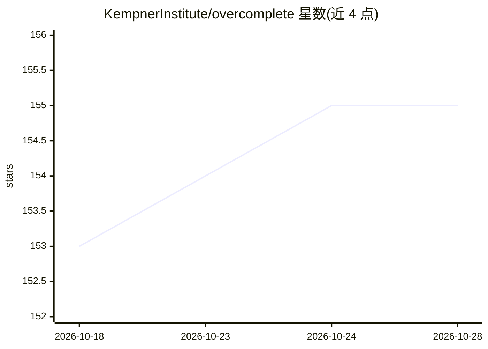

# KempnerInstitute/overcomplete

⭐ 155 · Python · MIT · 推送 2025-12-04 · [GitHub](https://github.com/KempnerInstitute/overcomplete) · [官网](https://kempnerinstitute.github.io/overcomplete) · 组织维护

**视觉大模型概念提取的 SAE/字典学习研究库**

基于 PyTorch 的紧凑研究库，面向从大型视觉模型中提取概念：提供 TopK/BatchTopK/JumpReLU/Vanilla/Archetypal 等 SAE 变体，以及优化式字典学习方法（NMF、ConvexNMF、Semi-NMF），并附带可视化模块、归因方法与评估指标。API 设计为少量超参数即可开始，强调实验性探索。需 Python 3.8+，通过 PyPI 安装，另提供入门与进阶 Notebook。仅支持 Torch。

## 筛选速览

| 维度 | 判定 | 备注 |
|---|---|---|
| AI 角色 | `ai-ecosystem` | LLM/agent 周边工具 |
| 许可风险 | `permissive` | MIT |
| 部署形态 | `library` | 以包/库形式分发 |
| 模型依赖 | — | README 未给出锁定关系 |
| 硬件要求 | — | 无带数字的原话,不猜 |
| 安装摩擦 | `low` | 无编译、无系统依赖或容器化 |
| 成熟度 | — | 结构信号不足 |

## 能力要点

- 多种 SAE 变体（TopK/BatchTopK/JumpReLU/Vanilla/Archetypal）与训练接口
- 字典学习方法（NMF/ConvexNMF/Semi-NMF）
- 可视化模块、归因方法与 SAE 解评估指标
- 配套入门与进阶 Notebook

## 适用场景

- 研究视觉模型内部概念表示
- 训练并分析 SAE 的死代码与稳定性
- 对 SAE 解做度量和可视化分析

## 场景标签

 · 领域:深度学习可解释性研究

## 证据(README 行号)

> L15: **Overcomplete** is a compact research library in Pytorch designed to study (Overcomplete)-Dictionary learning meth
> L25: With Overcomplete installed, you can dive into an optimisation based dictionary learning method to extract visual f

## 星数曲线

2026-10-18 153 → 2026-10-28 155（+2）

---
*卡片 v1 · prompt 1.4 · 生成 2026-10-22 · 置信度 high · 依据 README sha `a3050437632a` · [字段定义](../../DATASET.md)*
