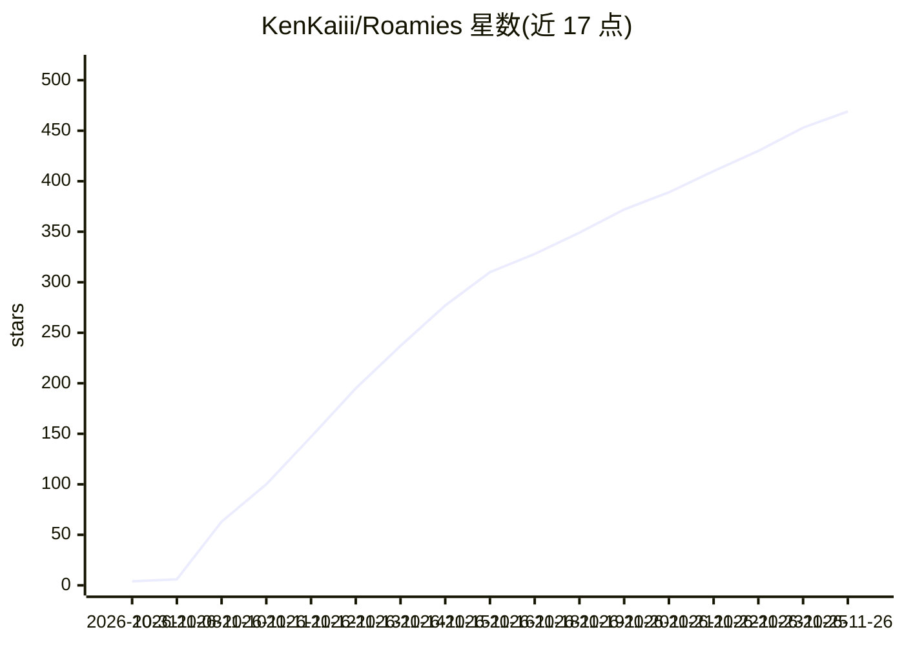

# KenKaiii/Roamies

⭐ 469 · JavaScript · AGPL-3.0 · 推送 2026-11-25 · [GitHub](https://github.com/KenKaiii/Roamies) · [官网](https://www.kenkais.com) · 个人维护

**桌面屏幕宠物 AI 助手：语音对话、记忆待办并指屏引导**

Roamies 是常驻桌面的像素角色（JARVIS、Roamie 等七种形象），围绕光标提供语音/文字对话、按秒提醒、屏幕标注与自动点击。语音回复走 Fish Audio 或 Gemini 语音（用户自有 key），登录可复用 Claude/ChatGPT 订阅或 API key；Windows/Linux 语音识别用 NVIDIA Parakeet 模型（约 670 MB，ONNX）。支持接入本地模型（Ollama/LM Studio/OpenAI 兼容服务），要求模型具备视觉、工具调用、GUI grounding 与 32k 上下文。提供 macOS/Windows 安装包与 Linux（beta）包，AGPL-3.0 许可。

## 筛选速览

| 维度 | 判定 | 备注 |
|---|---|---|
| AI 角色 | `ai-native` | 本体是模型或模型工具 |
| 许可风险 | `viral` | AGPL-3.0 |
| 部署形态 | `desktop` | 安装包/桌面程序 |
| 模型依赖 | local-ok | 支持本地模型 |
| 硬件要求 | — | 无带数字的原话,不猜 |
| 安装摩擦 | `low` | 无编译、无系统依赖或容器化 |
| 成熟度 | — | 结构信号不足 |

## 能力要点

- 语音/文字输入，支持圈选屏幕区域表达意图
- 在真实屏幕上圈出按钮并分步引导操作
- 按秒或周期性提醒，并记住用户的待办
- 支持 Ollama/LM Studio 等本地模型接入

## 适用场景

- 语音指挥助手打开应用、网站并代为点击
- 阅读时向助手提问并获得屏幕旁的图解答案
- 设定周期性后台任务（如定时总结新闻）
- 接入本地 Qwen3-VL 模型离线使用

## 场景标签

`AI 助手` `语音 Agent` `GUI 自动化` · 领域:效率与自动化

## 证据(README 行号)

> L15: Roamies is a little AI buddy that lives on your desktop. It stays by your cursor, talks back in its own
> L33: - **Your subscriptions.** Sign in with Claude or ChatGPT, or use an API key (Gemini, Grok, Kimi Code and more).
> L146: Roamies can run on a model on your own computer or server instead of a cloud provider: Ollama, LM Studio, or any

## 星数曲线

2026-10-31 4 → 2026-11-26 469（+465）

---
*卡片 v1 · prompt 1.4 · 生成 2026-11-25 · 置信度 mid · 依据 README sha `6c590dbd4068` · [字段定义](../../DATASET.md)*
