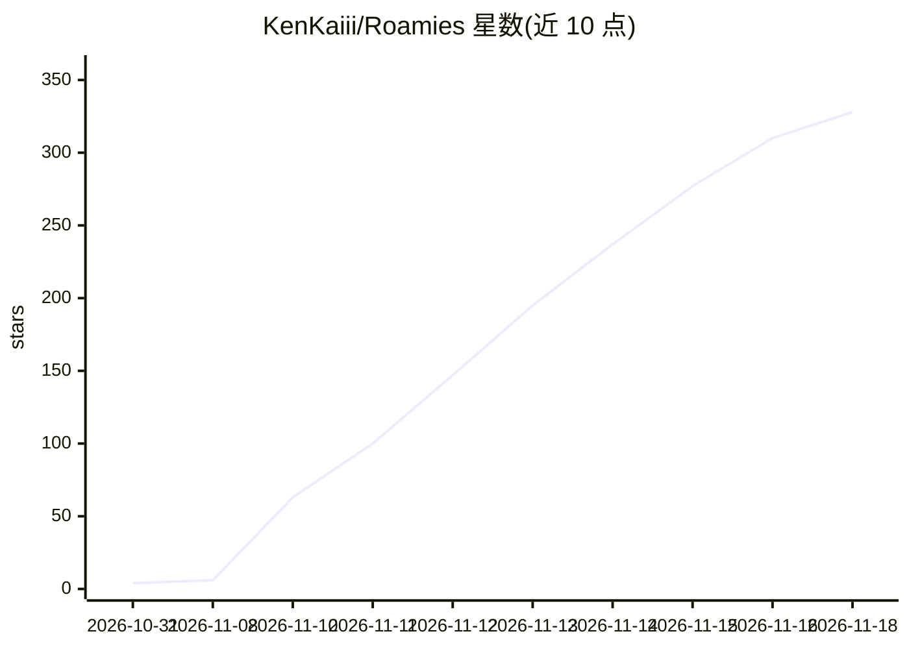

# KenKaiii/Roamies

⭐ 328 · JavaScript · AGPL-3.0 · 推送 2026-11-17 · [GitHub](https://github.com/KenKaiii/Roamies) · [官网](https://www.kenkais.com) · 个人维护

**住在桌面上、会说话和指点的 AI 小伙伴应用**

Roamies 是 Mac/Windows（Linux beta）桌面应用：一个常驻屏幕的像素小生物，支持语音或文字对话，用 Fish Audio 或 Gemini 语音回答；它记录用户说过要做的事并按精确或重复时间提醒，能在屏幕上圈出按钮、逐步讲解操作，也可代为打开应用并在其他应用中点击输入。AI 接入可选：Claude/ChatGPT 登录、Gemini/Grok/Kimi 等 API key，或本地 Ollama/LM Studio/llama.cpp/vLLM（模型需支持视觉、工具调用、GUI grounding 与 32k 以上上下文）。权限默认关闭，风险操作会先询问。

## 筛选速览

| 维度 | 判定 | 备注 |
|---|---|---|
| AI 角色 | `ai-native` | 本体是模型或模型工具 |
| 许可风险 | `viral` | AGPL-3.0 |
| 部署形态 | `desktop` | 安装包/桌面程序 |
| 模型依赖 | local-ok | 支持本地模型 |
| 硬件要求 | — | 无带数字的原话,不猜 |
| 安装摩擦 | `low` | 无编译、无系统依赖或容器化 |
| 成熟度 | `idea` | |

## 能力要点

- 语音对话+屏幕圈选指点，逐步引导点击按钮完成操作
- 记忆待办并支持精确到秒及重复周期的提醒
- 在屏幕旁绘制卡片、图表、时间线与 3D 模型辅助讲解
- 支持本地模型（Ollama/LM Studio/llama.cpp/vLLM），消息与截图留在本机

## 适用场景

- 让桌面小生物提醒我待办并监督执行
- 不熟悉某软件时，让它圈出按钮一步步教我操作
- 读网页时直接提问，在旁边看它画图讲解

## 场景标签

`AI 助手` `语音 Agent` `GUI 自动化` · 领域:效率与自动化

## 证据(README 行号)

> L14: Roamies is a little AI buddy that lives on your desktop. It stays by your cursor, talks back in its own
> L26: - **It talks back.** Spoken replies in its own voice, with real feeling, through Fish Audio, or in a Gemini voice y

## 星数曲线

2026-10-31 4 → 2026-11-18 328（+324）

---
*卡片 v1 · prompt 1.4 · 生成 2026-11-17 · 置信度 mid · 依据 README sha `45f42c60ac13` · [字段定义](../../DATASET.md)*
