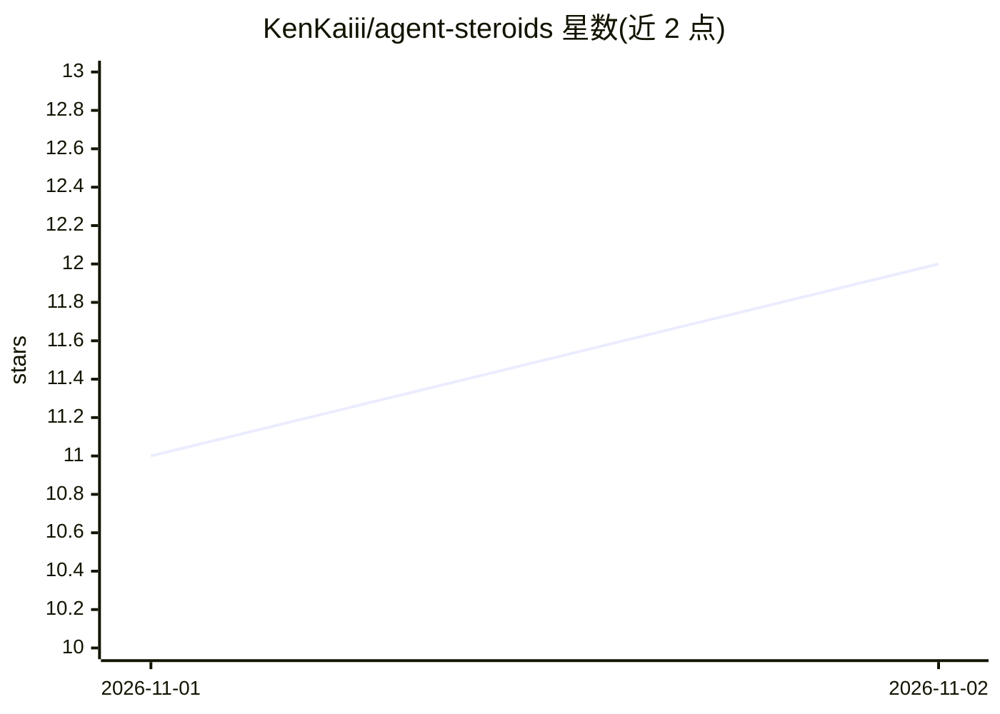

# KenKaiii/agent-steroids

⭐ 12 · Rust · AGPL-3.0 · 推送 2026-10-06 · [GitHub](https://github.com/KenKaiii/agent-steroids) · 个人维护

**为编码 agent 提供本地开源代码语料库与正则搜索的 CLI 工具**

单个 Rust 二进制，下载精选开源仓库到本地磁盘并建立索引，供用户本人或编码 agent 在写代码前搜索真实实现。机制上：tarball 流式过滤（丢弃图片/文档/测试等约90%内容）、zstd 共享字典压缩、三元组索引加正则确认；add/update 不调 GitHub API、无限流，支持标签、自动发现、decay 淘汰、便携 SSD 根目录迁移。无服务器、无 MCP、无 API key，靠 agent 调用 `steroids search` 命令生效。

## 筛选速览

| 维度 | 判定 | 备注 |
|---|---|---|
| AI 角色 | `ai-ecosystem` | LLM/agent 周边工具 |
| 许可风险 | `viral` | AGPL-3.0 |
| 部署形态 | `library` | 以包/库形式分发 |
| 模型依赖 | — | README 未给出锁定关系 |
| 硬件要求 | — | 无带数字的原话,不猜 |
| 安装摩擦 | `low` | 无编译、无系统依赖或容器化 |
| 成熟度 | — | 结构信号不足 |

## 能力要点

- 单个 Rust 二进制，无运行时/守护进程/服务器/API key
- 三元组索引+正则确认的本地代码搜索，单次搜索约0.009s
- 500 仓库 starter pack 约 1.8GB，30 个分类，可离线使用
- add/update 零 GitHub API 调用，走 codeload 拉取无限流

## 适用场景

- 让 Claude Code/Cursor 等编码 agent 写代码前先读真实实现
- 本地维护并搜索自己挑选的开源代码语料库
- 离线环境或高频搜索场景下替代托管代码搜索 API

## 场景标签

`精选清单` · 领域:学习与行业

## 证据(README 行号)

> L23: Real projects, downloaded to your machine. Your agent **reads them before it writes.**
> L96: That's it. No plugin, no server. Your agent calls it the same way it calls `grep`.

## 星数曲线

2026-11-01 11 → 2026-11-02 12（+1）

---
*卡片 v1 · prompt 1.4 · 生成 2026-11-02 · 置信度 high · 依据 README sha `bf71be0f47fe` · [字段定义](../../DATASET.md)*
