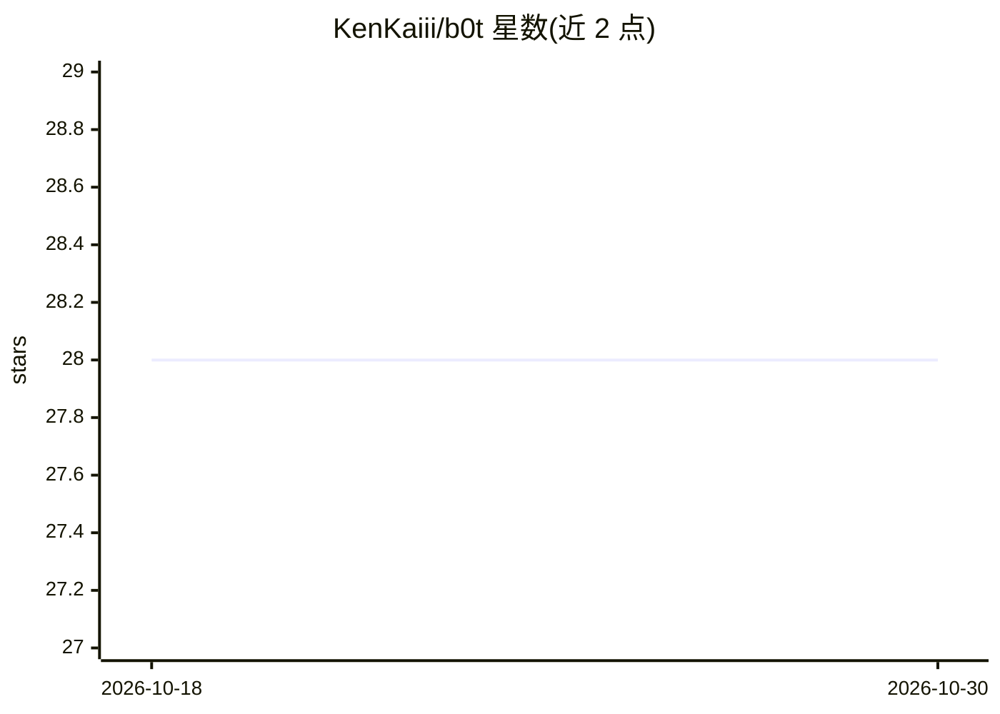

# KenKaiii/b0t

⭐ 28 · TypeScript · 推送 2025-11-22 · [GitHub](https://github.com/KenKaiii/b0t) · [官网](https://www.youtube.com/kenkaidoesai) · 个人维护

**用自然语言对话创建自动化工作流的自托管平台**

工作流自动化平台，构建方式是与 Claude Code 对话：用户用自然语言描述需求，Claude 读取 140 个模块中的 900+ 个函数，生成工作流 JSON 并保存到仪表板。工作流支持手动运行、cron 定时、webhook 触发、Telegram/Discord 机器人触发等。模块覆盖 Slack、GitHub、PostgreSQL、Stripe、OpenAI 等服务及 250+ 工具函数，包含熔断、限流、重试与 AES-256 凭证加密；支持多租户与自托管，每个模块为 TypeScript 文件可自行扩展。基于 Next.js 15、BullMQ + Redis 构建。

## 筛选速览

| 维度 | 判定 | 备注 |
|---|---|---|
| AI 角色 | `ai-enhanced` | 去掉 AI 部分产品仍成立 |
| 许可风险 | `none` | — |
| 部署形态 | `library` | 以包/库形式分发 |
| 模型依赖 | — | README 未给出锁定关系 |
| 硬件要求 | — | 无带数字的原话,不猜 |
| 安装摩擦 | `low` | 无编译、无系统依赖或容器化 |
| 成熟度 | — | 结构信号不足 |

## 能力要点

- 对话式创建工作流，Claude Code 生成并验证工作流 JSON
- 140 模块 900+ 可组合函数，HTTP 模块可调用任意 API
- 熔断/限流/自动重试/结构化日志/AES-256 凭证加密
- 多租户架构，模块以 TypeScript 文件形式可扩展

## 适用场景

- 不用可视化编辑器，用对话方式搭建跨服务自动化
- 自托管运行定时/监控/通知类工作流，掌握自己的数据
- 代理或团队为多客户隔离管理自动化与凭证

## 场景标签

`工作流自动化` · 领域:效率与自动化

## 证据(README 行号)

> L39: You describe what you want to Claude Code in plain English. Claude reads through 900+ available functions across 14
> L104: Zapier/Make won't let you modify their integrations. n8n is technically extensible, but good luck figuring out the

## 星数曲线

2026-10-18 28 → 2026-10-30 28（+0）

---
*卡片 v1 · prompt 1.4 · 生成 2026-10-26 · 置信度 high · 依据 README sha `3d94ad656cb7` · [字段定义](../../DATASET.md)*
