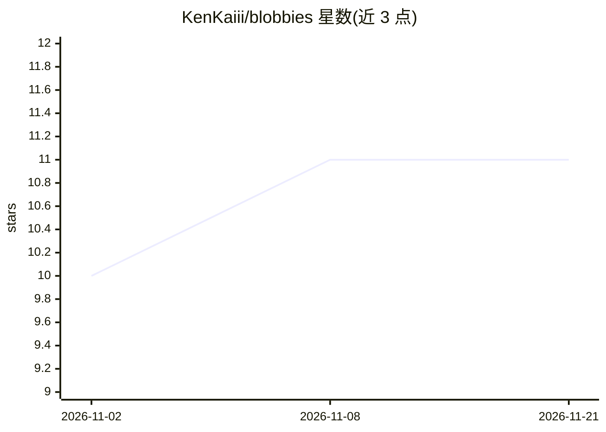

# KenKaiii/blobbies

⭐ 11 · TypeScript · AGPL-3.0 · 推送 2026-11-19 · [GitHub](https://github.com/KenKaiii/blobbies) · [官网](https://www.kenkais.com) · 个人维护

**本地优先的多 AI 助手桌面应用，数据不出本机**

macOS/Windows/Linux 桌面应用，用户可创建多个名为 Blob 的 AI 助手，各自拥有记忆、定时例程与可执行工具：通过 Composio 账户操作 Gmail/Slack/Notion 等 942 个应用、本地 Rust 实现的 PDF/OCR 文本提取、DuckDuckGo 网络搜索、白名单本地命令，支持 6 个 Blob 群聊协作与 Blob 互相复制。模型路径仅两种：本地 Ollama 或 Tinfoil 机密计算 enclave，其他 provider 在构建层被拒绝；数据存于 ~/.blobbies，无遥测。通过 Agent Client Protocol 可从 Zed/JetBrains 编辑器接入同一批 Blob。

## 筛选速览

| 维度 | 判定 | 备注 |
|---|---|---|
| AI 角色 | `ai-native` | 本体是模型或模型工具 |
| 许可风险 | `viral` | AGPL-3.0 |
| 部署形态 | `desktop` | 安装包/桌面程序 |
| 模型依赖 | local-ok | 支持本地模型 |
| 硬件要求 | — | 无带数字的原话,不猜 |
| 安装摩擦 | `low` | 无编译、无系统依赖或容器化 |
| 成熟度 | — | 结构信号不足 |

## 能力要点

- 每个 Blob 独立记忆+团队事实，全部可查看/编辑/删除
- 仅支持本地 Ollama 与 Tinfoil attested enclave 两条模型路径
- Composio 插件目录 942 个应用；PDF/OCR 在本地 Rust 完成
- 支持 MCP 服务器、ACP 编辑器接入与 Blob 自我复制管理

## 适用场景

- 让 AI 助手定时整理邮箱、日历并起草回复
- 在离线环境下用本地模型处理文档与截图
- 不希望邮件等数据发送给 AI 公司的用户

## 场景标签

`AI 助手` `工作流自动化` · 领域:效率与自动化

## 证据(README 行号)

> L17: Little AI teammates called **Blobs**. Make one, name it, give it a job. One for email, one for research, one that h
> L19: They remember you. They work in your apps. And **your data never touches an AI company.**
> L65: ||**Local (Ollama)**|**Tinfoil**|

## 星数曲线

2026-11-02 10 → 2026-11-21 11（+1）

---
*卡片 v1 · prompt 1.4 · 生成 2026-11-19 · 置信度 mid · 依据 README sha `74dd38cbbd31` · [字段定义](../../DATASET.md)*
